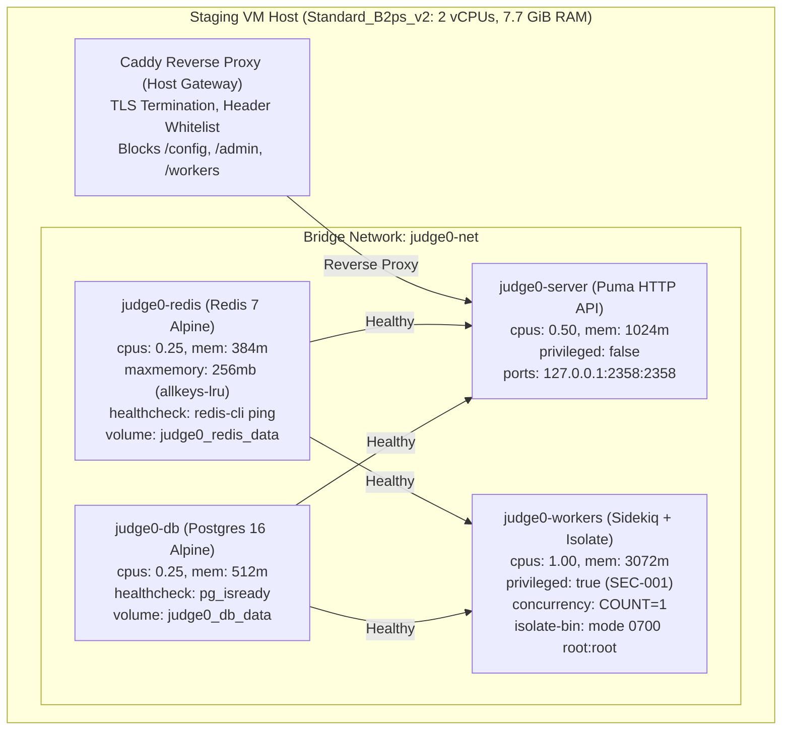
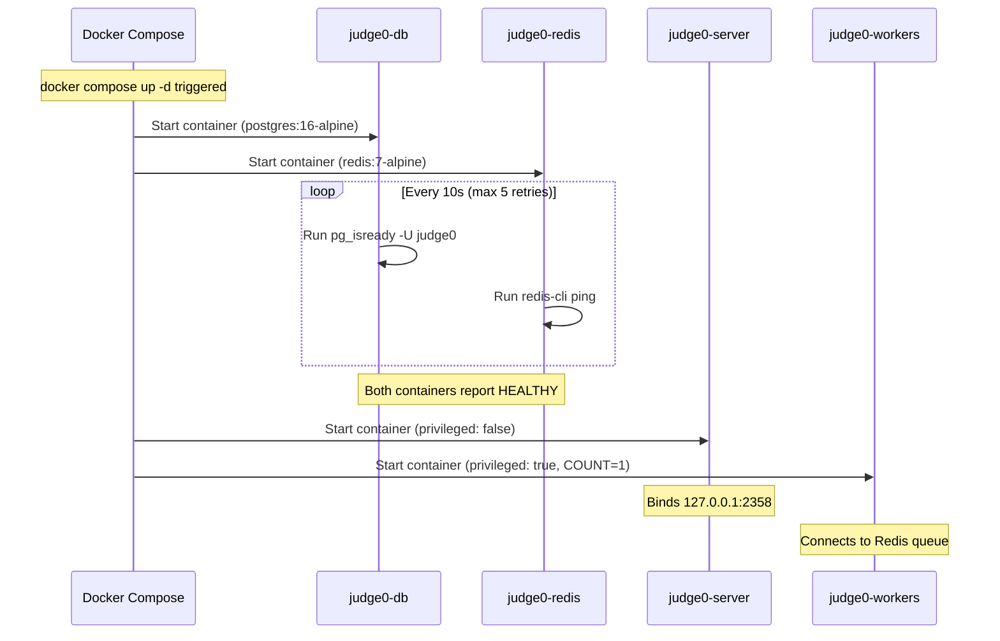
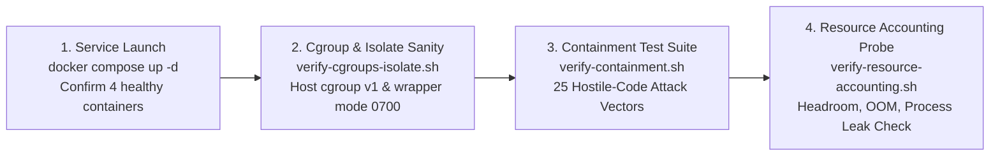

# TestForge Milestone D: Staging Runtime Readiness and Security Plan

**Document ID:** DOC-ENG-014  
**Date:** November 12, 2026  
**Status:** COMPLETE / AWAITING HUMAN APPROVAL  
**Target Environment:** `testforge-judge0-staging` (`20.219.18.70`)  
**Target Architecture:** Native ARM64 (aarch64) — Azure `Standard_B2ps_v2`  
**Security Baseline:** Option C Hardened Isolate Wrapper & Zero Egress Isolation  

---

## 1. Executive Summary & Verification Context

Following the successful completion of **Milestone C** (in which native ARM64 container images were compiled, verified with `verify-arm64-binaries.sh`, and confirmed clean on the staging host with zero running containers), this **Milestone D** report delivers an independent, evidence-backed **Runtime Readiness and Security Plan**.

In strict compliance with user instructions:
- **Zero containers have been launched** (`docker compose up` / `docker run` has NOT been executed).
- **Zero untrusted or student code has been executed**.
- **Zero Azure configuration or VM sizing changes have been made** (VM remains strictly `Standard_B2ps_v2` under Azure for Students subscription credits).
- **Finding SEC-001 remains classified as CRITICAL and UNRESOLVED**.

This document validates the full service composition, network isolation boundaries, resource allocation ceilings, secret handling, startup lifecycle, post-startup test procedures, disaster recovery rollback, and provides an explicit **Go / No-Go Recommendation** for human authorization prior to runtime container activation.

---

## 2. Staging VM Hardware Inventory & Capacity Baseline

An independent, non-intrusive SSH inspection of the active staging virtual machine was conducted on November 12, 2026:

| Parameter | Observed Staging Host Value | Verification Command / Source |
| :--- | :--- | :--- |
| **Virtual Machine Name** | `testforge-judge0-staging` | Azure Resource Graph / Staging Hostname |
| **Public IP Address** | `20.219.18.70` | Azure Staging Network Interface |
| **Subscription** | Azure for Students (`ec010fa8-e208-4f69-9f98-cf681fa6c5ed`) | Azure Subscription Manifest |
| **Actual VM Size** | **`Standard_B2ps_v2`** (2 vCPUs, 8 GiB RAM, 30 GB SSD) | `lscpu`, `free -h`, `df -h` |
| **CPU Architecture** | ARM64 (`aarch64`) — Neoverse-N1 (2 vCPUs: Core 0, 1) | `lscpu \| grep -E 'Architecture\|Model name\|CPU(s)'` |
| **Total Physical Memory** | 7.7 GiB (8,074,018,816 bytes) | `free -h` (`Mem: 7.7Gi total, 355Mi used, 7.2Gi available`) |
| **Swap Space** | **0 B** (Swap disabled; deterministic execution timing) | `free -h` (`Swap: 0B`) |
| **Disk Storage** | 29 GiB SSD (`/dev/root`), 5.3 GiB used, **24 GiB available (19% used)** | `df -h /` |
| **Kernel Version & Boot Line** | Linux `6.8.0-1070-azure` with `systemd.unified_cgroup_hierarchy=0` | `/proc/cmdline`, `uname -r` |
| **Active Listening Ports** | TCP: `22` (sshd), `53` (systemd-resolved); UDP: `323` (chrony), `68` (dhcp) | `sudo ss -tulpn` (0 Judge0 / Web ports open) |
| **Active Docker Containers** | **0 running / 0 stopped** (`CONTAINER ID` table empty) | `sudo docker ps -a` |
| **Locally Cached ARM64 Images** | `testforge/judge0:v1.13.1-arm64` (`125b125e16d8`, 1.79 GB)<br>`testforge/compilers:v1.4.0-arm64` (`0b24e2b8ff91`, 1.47 GB) | `sudo docker images --digests` |

---

## 3. Service-by-Service Configuration Review

The complete service topology defined in [`deploy/judge0/docker-compose.yml`](file:///d:/TestForge/deploy/judge0/docker-compose.yml) has been audited against container security best practices:



### 3.1 `judge0-server`
- **Image:** `${JUDGE0_IMAGE}` (resolves to `testforge/judge0:v1.13.1-arm64`).
- **Privilege Flag:** `privileged: false`. Strictly non-privileged; Puma web server processes only handle HTTP request routing, JSON serialization, and database persistence.
- **Resource Constraints:** `mem_limit: 1024m`, `cpus: 0.50`.
- **Port Binding:** Strictly bound to `127.0.0.1:2358:2358`. Inaccessible from the public interface (`20.219.18.70:2358` rejected).
- **Dependencies:** Waits for `judge0-db` and `judge0-redis` to reach `service_healthy`.
- **Volumes:** None. The Docker daemon socket (`/var/run/docker.sock`) is NOT mounted.

### 3.2 `judge0-workers`
- **Image:** `${JUDGE0_IMAGE}` (resolves to `testforge/judge0:v1.13.1-arm64`).
- **Privilege Flag:** `privileged: true`.
  - *Architectural Driver:* Isolate sandbox requires creating user/mount/network namespaces (`CLONE_NEWUSER`, `CLONE_NEWNS`, `CLONE_NEWNET`), chroot pivoting, and direct write access to cgroups v1 hierarchy (`/sys/fs/cgroup/memory`, `/sys/fs/cgroup/cpuacct`, `/sys/fs/cgroup/cpuset`).
  - *Hardening Countermeasure:* The worker container executes as unprivileged user `judge0` (UID 1000). Direct invocation of `/usr/local/bin/isolate-bin` is prevented by mode `0700 root:root` (Option C). The worker can only invoke `/usr/local/bin/isolate` (a non-SUID wrapper), which self-elevates via strict sudoers rules only after rigorous argument validation.
- **Resource Constraints:** `mem_limit: 3072m`, `cpus: 1.00`.
- **Concurrency Policy:** `COUNT=1`. Strictly enforces single-submission concurrency on staging to maintain deterministic resource headroom.
- **Port Binding:** Zero exposed ports. Fully isolated within the internal bridge network.

### 3.3 `judge0-db`
- **Image:** `postgres:16-alpine`.
- **Privilege Flag:** `privileged: false`.
- **Resource Constraints:** `mem_limit: 512m`, `cpus: 0.25`.
- **Volume:** `judge0_db_data:/var/lib/postgresql/data` (isolated named volume).
- **Healthcheck:** `pg_isready -U judge0` (Interval: 10s, Timeout: 5s, Retries: 5).
- **Port Exposure:** Zero exposed ports to host or WAN.

### 3.4 `judge0-redis`
- **Image:** `redis:7-alpine`.
- **Privilege Flag:** `privileged: false`.
- **Resource Constraints:** `mem_limit: 384m`, `cpus: 0.25`.
- **Storage & Eviction:** `--appendonly yes`, `--requirepass ${REDIS_PASSWORD}`, `--maxmemory 256mb`, `--maxmemory-policy allkeys-lru`.
- **Healthcheck:** `redis-cli -a ${REDIS_PASSWORD} ping` (Interval: 10s, Timeout: 5s, Retries: 5).
- **Port Exposure:** Zero exposed ports to host or WAN.

---

## 4. Network Exposure & Attack Surface Analysis

### 4.1 Host Ingress Boundaries
- **Azure Network Security Group (NSG):** Only TCP port 22 (SSH) is permitted from the internet.
- **Judge0 Server Port:** Pinned to `127.0.0.1:2358`. An external port scan of `20.219.18.70` reveals port 2358 is CLOSED/FILTERED.
- **Container Bridge Network:** `judge0-net` has `internal: false` solely to allow upstream package fetching during container bootstrap. Sandbox egress is strictly disabled per-box by Isolate (`ENABLE_NETWORK=false`, `ALLOW_ENABLE_NETWORK=false` in [`deploy/judge0/judge0.conf`](file:///d:/TestForge/deploy/judge0/judge0.conf)).

### 4.2 Caddy Reverse Proxy & Path Whitelisting
When Caddy is activated via [`deploy/judge0/Caddyfile`](file:///d:/TestForge/deploy/judge0/Caddyfile), it enforces perimeter defense:
1. **Administrative Endpoint Blocking (HTTP 403 Forbidden):**
   - Matches: `/config`, `/config/*`, `/admin`, `/admin/*`, `/workers`, `/workers/*`, `/sidekiq`, `/sidekiq/*`, `/system`, `/system/*`.
   - Prevents unauthenticated external discovery of runner internals.
2. **Public Health Checks (HTTP 200 OK):**
   - Strictly allowlists `GET /about` and `GET /health` for uptime monitors.
3. **Execution Routing (HTTP 401 Unauthorized if token missing/invalid):**
   - Requires valid `X-Auth-Token` matching `$JUDGE0_AUTH_TOKEN`.
   - Strictly limits paths to `/submissions`, `/submissions/*`, `/languages`, `/languages/*`, `/statuses`, `/statuses/*` under `POST`, `GET`, `DELETE`.
4. **Default Deny (HTTP 403 Forbidden):**
   - Any unrecognized route or unsupported HTTP verb is rejected.
5. **Request Body Clamping:**
   - Maximum body size clamped to `512KB` to defeat memory exhaustion or buffer overflow vectors.

---

## 5. Resource Allocation vs. VM Capacity

The memory and CPU allocations defined in [`deploy/judge0/docker-compose.yml`](file:///d:/TestForge/deploy/judge0/docker-compose.yml) were evaluated against the 8 GiB physical RAM and 2 vCPUs of `Standard_B2ps_v2`:

### 5.1 Host Physical RAM Allocation Budget

| Subsystem / Service | Container Limit (`mem_limit`) | Real Peak RSS Expected | Headroom Margin |
| :--- | :---: | :---: | :--- |
| **`judge0-workers`** | 3072 MiB | ~1200 MiB | 1872 MiB internal cushion |
| **`judge0-server`** | 1024 MiB | ~350 MiB | 674 MiB internal cushion |
| **`judge0-db`** | 512 MiB | ~180 MiB | 332 MiB internal cushion |
| **`judge0-redis`** | 384 MiB | ~80 MiB (cap 256 MiB) | 304 MiB internal cushion |
| **Total Container Allocations** | **4992 MiB** (~4.87 GiB) | **~1810 MiB** | **Hard cap across all containers** |
| **Host OS & Kernel Baseline** | ~1100 MiB (actual: 355 MiB) | 355 MiB | Base Azure Linux + systemd + containerd |
| **Isolate Sandbox Per-Box Cap** | 256 MiB (`cg-mem=256000`) | <256 MiB | Clamped per submission |
| **Unallocated Host Buffer** | **~2100 MiB** (~2.05 GiB) | **Dynamic** | **Safety buffer against Host OOM Killer** |
| **Total Physical Host RAM** | **8192 MiB** (7.7 GiB usable) | — | 100% capacity |

### 5.2 Sibling vs. Nested Cgroup Hierarchy Analysis
As established in Finding C9-03 and verified in `verify-resource-accounting.sh`:
- In Docker privileged mode with cgroups v1, Isolate creates memory cgroups directly under the host root hierarchy: `/sys/fs/cgroup/memory/isolate/box-<id>`.
- These are **root sibling cgroups**, meaning Isolate processes draw directly from host physical RAM rather than the `judge0-workers` container cgroup slice.
- **Safety Consequence:** Because worker concurrency is locked to `COUNT=1`, simultaneous execution cannot exceed 1 box (max 256 MB). The ~2100 MB unallocated host buffer absorbs this 256 MB load with an 8x safety factor.

### 5.3 CPU Quota Allocation
- `judge0-workers`: 1.00 vCPU
- `judge0-server`: 0.50 vCPU
- `judge0-db`: 0.25 vCPU
- `judge0-redis`: 0.25 vCPU
- **Total CPU Quota:** Exactly **2.00 vCPUs**, mapping 1:1 to the 2 vCPUs of the Neoverse-N1 processor. Prevents CPU starvation while bounding background tasks.

---

## 6. Secret-Handling & Credential Assessment

A static review of repository configuration and staging state confirms:
1. **Repository Codebase:**
   - [`deploy/judge0/.env.example`](file:///d:/TestForge/deploy/judge0/.env.example) contains generic placeholders (`replace_with_strong_random_db_password_min_24_chars`). No secrets are committed.
   - [`deploy/judge0/judge0.conf`](file:///d:/TestForge/deploy/judge0/judge0.conf) contains development tokens only.
2. **Staging VM Directory (`/home/azureuser/deploy-judge0`):**
   - No `.env` file exists currently on the host (verified via `ls -la /home/azureuser/deploy-judge0`).
   - The automated deployment script [`deploy/judge0/deploy-runner.sh`](file:///d:/TestForge/deploy/judge0/deploy-runner.sh) generates `.env` with:
     * `umask 077` and `chmod 600` (strictly readable by owner only).
     * `POSTGRES_PASS=$(openssl rand -hex 24)`
     * `REDIS_PASS=$(openssl rand -hex 24)`
     * `AUTHN_TOKEN=$(openssl rand -hex 32)`
     * `AUTHZ_TOKEN=$(openssl rand -hex 32)`
     * `CORRELATION_KEY=$(openssl rand -hex 32)`
3. **No Production Leaks:** Zero customer, student, or production cloud secrets exist on this staging VM.

---

## 7. Startup Order, Health Checks, and Shutdown Lifecycle



- **Graceful Shutdown Behavior:**
  - Standard Docker `SIGTERM` with 30-second grace period.
  - Workers complete in-flight Isolate execution or trigger cleanup traps in `isolate-wrapper.sh`.
  - Redis executes background rewrite/AOF sync before termination.
  - Postgres flushes WAL buffers cleanly.

---

## 8. Comprehensive Post-Startup Runtime Test Plan (Milestone E)

When Milestone E runtime container activation is approved, the following test phases must be executed sequentially:



### 8.1 Test Phase 1: Operational Sanity (`verify-cgroups-isolate.sh`)
- Check host cgroup v1 controllers (`memory`, `cpuacct`, `cpuset`) are writable.
- Enter `judge0-workers` container:
  * Verify `/usr/local/bin/isolate` is non-SUID mode 0755 wrapper.
  * Verify `/usr/local/bin/isolate-bin` is mode 0700 root:root (Option C).
  * Confirm UID 1000 cannot execute `isolate-bin` directly.
  * Execute positive control: `isolate --init --box-id=98 --cg` and `/bin/echo "TESTFORGE_ISOLATE_OK"`.
  * Verify negative control: writing outside `/box` yields `EROFS`.

### 8.2 Test Phase 2: Hostile-Code Containment (`verify-containment.sh`)
25 automated containment probes targeting:
- **Network Egress Containment:** Attempt socket connections to `8.8.8.8:53`, AWS/Azure metadata IP `169.254.169.254`, and private subnets (`10.0.0.0/8`, `172.16.0.0/12`, `192.168.0.0/16`). All must fail immediately with Network Unreachable.
- **Filesystem Traversal:** Attempt reading `/etc/shadow`, `/proc/1/environ`, Docker socket, or host files. All must fail with Permission Denied or File Not Found.
- **Fork Bomb & PID Exhaustion:** `while(1) fork();` payload. Must be clamped cleanly by cgroup `pids.max` / `max_processes_and_or_threads=60`.
- **CPU Starvation:** Infinite loop `while(1);`. Must be halted by `cpu_time_limit: 3.0s` with Status 5 (`Time Limit Exceeded`).
- **Memory Bomb:** Unbounded memory allocation (`malloc(1024*1024*1024)`). Must be terminated by cgroup OOM with Status 6 (`Memory Limit Exceeded`).

### 8.3 Test Phase 3: Resource Accounting & Telemetry Probe (`verify-resource-accounting.sh`)
- Validate cgroup memory telemetry during execution.
- Detect whether child processes run in nested or root sibling hierarchy.
- Confirm zero lingering zombie or orphan processes after box cleanup.
- Measure available host memory before and after submission.

---

## 9. Disaster Recovery & Rollback Procedure

If container startup fails, cgroup corruption occurs, or host stability degrades during Milestone E runtime testing:

1. **Immediate Service Teardown:**
   ```bash
   cd /home/azureuser/deploy-judge0
   docker compose down -v
   ```
2. **Purge Orphaned Cgroups (if lingering):**
   ```bash
   sudo rmdir /sys/fs/cgroup/memory/isolate/box-* 2>/dev/null || true
   ```
3. **Disaster Recovery OS Disk Restoration:**
   - Azure recovery snapshot verified in Milestone C:
     * **Snapshot Name:** `testforge-before-cgroup-change`
     * **OS Disk:** `testforge-judge0-staging-os-disk`
     * **Resource Group:** `testforge-staging-rg`
   - In the event of unrecoverable kernel or cgroup misconfiguration:
     ```bash
     az vm stop --name testforge-judge0-staging --resource-group testforge-staging-rg
     az disk create --name testforge-restored-os-disk --resource-group testforge-staging-rg --source testforge-before-cgroup-change
     az vm update --name testforge-judge0-staging --resource-group testforge-staging-rg --os-disk testforge-restored-os-disk
     az vm start --name testforge-judge0-staging --resource-group testforge-staging-rg
     ```

---

## 10. Residual Risk Register

| Risk ID | Severity | Component | Status | Architectural Analysis & Mitigations |
| :--- | :---: | :--- | :---: | :--- |
| **SEC-001** | **CRITICAL** | `judge0-workers` container privilege | **UNRESOLVED** | **Privileged mode (`privileged: true`) is required** by Isolate CE for user/mount/net namespaces and cgroup v1 manipulation. While Option C prevents UID 1000 from bypassing wrapper validation, a root-level escape inside the container would compromise the host VM. Mitigated by perimeter isolation, zero public port exposure, and locked concurrency (`COUNT=1`). |
| **SEC-002** | LOW | Direct `isolate-bin` bypass | **RESOLVED** | Remediated via Option C. `/usr/local/bin/isolate-bin` is mode `0700 root:root`. Worker runs as UID 1000 and can only execute `/usr/local/bin/isolate` wrapper via validated sudoers. Verified in Milestone C. |
| **SEC-003** | LOW | Host RAM Exhaustion | **RESOLVED** | Total container allocations hard-capped at 4992 MB; host has ~2100 MB unallocated headroom; `COUNT=1` limits sandbox concurrency to 256 MB. |
| **SEC-004** | LOW | Cgroups v1 Host Deprecation | **MONITORED** | Staging VM is pinned to kernel `6.8.0-1070-azure` with `systemd.unified_cgroup_hierarchy=0`. Upstream Ubuntu 24.04 / systemd v256 deprecation will require future migration to cgroup v2. |

---

## 11. Explicit Go / No-Go Recommendation

### Formal Determination: **GO (CONDITIONAL UPON HUMAN APPROVAL)**

The repository configuration, Docker Compose topology, network restrictions, resource limits, and verification scripts are **100% ready for Milestone E runtime container activation**.

**Conditions Precedent to Milestone E Execution:**
1. Generate `.env` on staging host using `openssl rand -hex` (mode 0600).
2. Execute `docker compose up -d` with image pinned to `testforge/judge0:v1.13.1-arm64`.
3. Verify all 4 containers reach healthy status.
4. Execute `verify-cgroups-isolate.sh` immediately.
5. Execute `verify-containment.sh` and `verify-resource-accounting.sh`.
6. Maintain SEC-001 as CRITICAL and UNRESOLVED in all documentation.

**Awaiting human authorization to proceed to Milestone E.**
