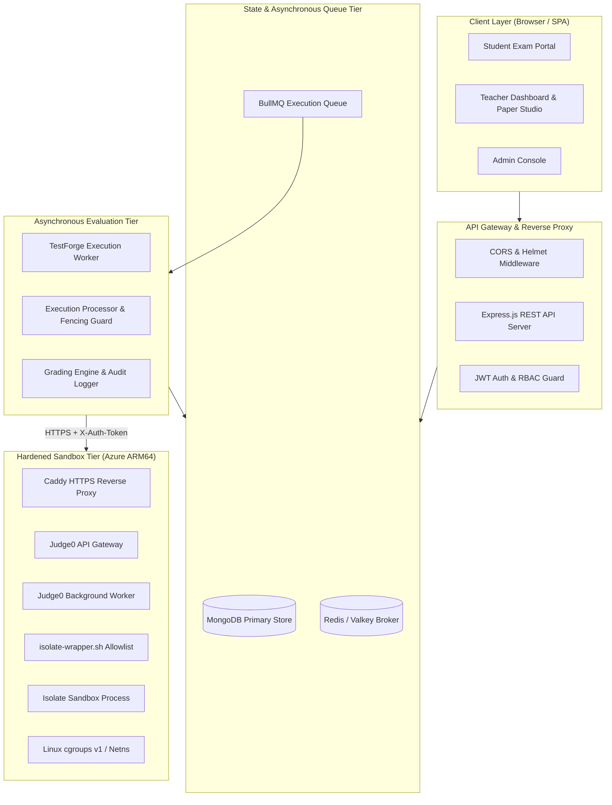

# SYSTEM ARCHITECTURE & SECURITY TOPOLOGY: TESTFORGE

**Document ID:** DOC-ENG-004  
**Version:** 1.0.0  
**Status:** Authoritative Architecture Reference  
**Date:** November 12, 2026  
**Primary Architect:** Antigravity Engineering Agent

---

## 1. High-Level Architecture Overview

TestForge employs a decoupled, multi-tier asynchronous architecture designed to enforce strict security boundaries between user-facing web clients, administrative logic, persistent data stores, and untrusted code execution environments.



---

## 2. Coding Assessment Execution Pipeline

Executing untrusted, adversarial student code requires strict temporal and spatial decoupling. The pipeline operates as follows:

```
[Student Browser]
       │  1. POST /api/attempts/:id/submit { questionId, code, language }
       ▼
[TestForge Express API]
       │  2. Authenticate JWT & Validate Exam Session Ownership
       │  3. Persist Submission doc (status: "queued")
       │  4. Enqueue BullMQ Job
       ▼
[HTTP 202 Accepted] ──> Returns submissionId immediately to Student Browser (non-blocking)
       
[BullMQ / Redis Broker]
       │  5. Dequeue job by TestForge Worker
       ▼
[TestForge Worker Process]
       │  6. Acquire Execution Lease & Fencing Token in MongoDB
       │  7. Load Question and Hidden Test Cases from MongoDB
       │  8. Prepare Execution Payload (Source Code + Test Input)
       │  9. Dispatch to Authenticated Provider (RenderSandboxProvider)
       ▼
[Caddy HTTPS Reverse Proxy (Azure VM)]
       │  10. Validate X-Auth-Token / Bearer Secret
       ▼
[Judge0 CE ARM64 API & Worker]
       │  11. Compute HMAC-SHA256 Correlation Hash from CORRELATION_KEY
       │  12. Dispatch to isolate-wrapper.sh via Open3.capture3(*cmd)
       ▼
[isolate-wrapper.sh]
       │  13. Validate single action (--run), integer box ID, allowed cgroups & mounts
       │  14. Enforce Zero Egress (reject --share-net)
       ▼
[Isolate Sandbox (v1.10.1)]
       │  15. Execute user binary inside isolated Mount, PID, IPC, UTS, and Network namespaces
       │  16. Enforce hard limits: memory, CPU time, wall clock, process count
       ▼
[Execution Telemetry Output]
       │  17. Isolate returns stdout, stderr, exit code, runtimeMs, memoryKB
       │  18. Judge0 worker emits structured [CORRELATION] log
       │  19. Wrapper executes --cleanup to wipe sandbox directory
       ▼
[TestForge Worker Process]
       │  20. Grade output against expected output (Sample & Hidden)
       │  21. Calculate marks via attemptGrading.service.js
       │  22. Update StudentAnswer with optimistic locking version counter
       │  23. Commit results to MongoDB (with 2-phase compensating rollback if audit fails)
       │  24. Mark Submission as "completed"
       ▼
[Student Browser Polling / SSE]
       │  25. Fetches submission status -> Renders scorecard (Hidden test data redacted)
```

---

## 3. Strict Separation of Concerns & Trust Boundaries

| Component | Trust Level | Owns | Must NEVER Access |
| :--- | :--- | :--- | :--- |
| **Student Client** | Completely Untrusted | Editor UI, local draft code, public test execution trigger. | Hidden test inputs, expected outputs, reference solutions, grading algorithms. |
| **TestForge API** | Trusted Authority | User authentication, exam sessions, question metadata, test case persistence. | Direct compilation or local execution of student code on host OS. |
| **TestForge Worker** | Trusted Authority | Grading logic, score calculations, audit logs, queue lease management. | Untrusted shell execution; direct container escape paths. |
| **Judge0 Runner** | Semi-Trusted Sandbox Host | Source compilation, Isolate sandbox lifecycle, resource accounting telemetry. | Student marks, exam ownership, database persistence authority. |
| **Isolate Sandbox** | Hostile Jail | Raw untrusted student binary execution. | Host filesystem, external network, Azure metadata endpoint, peer containers. |

---

## 4. Concurrency, Idempotency & Two-Phase Rollback

To guarantee consistent grading even during network partitions, worker crashes, or competing retries, TestForge implements:

1. **Fencing Tokens:**
   * Each execution job generates a unique cryptographically random `executionOwner` token.
   * MongoDB atomic updates (`findOneAndUpdate`) ensure only the current lease holder can write execution state.
2. **Periodic Lease Renewal:**
   * Long-running compilations and test batches renew their lease every 5 seconds. If the worker stalls or is killed by an OOM, the lease expires and is safely recovered by `executionRecovery.js`.
3. **Optimistic Versioning on Answers:**
   * `StudentAnswer` documents carry a `gradingVersion` integer. Concurrent writes fail closed if the version has changed.
4. **Two-Phase Compensating Rollback:**
   * When `attemptGrading.service.js` updates a student's answer score, it immediately writes an audit record to `GradingAuditLog`. If the audit log write fails, a compensating transaction rolls back the score to its previous state.

---

## 5. Defense-in-Depth Sandbox Architecture

The Judge0 staging environment on Azure ARM64 implements multiple layered defense rings:

1. **Ring 0 (Network Ingress):** Azure Network Security Group (NSG) restricting port 443 to authorized TestForge IPs, fronted by Caddy reverse proxy with strict header token validation.
2. **Ring 1 (Worker Process Separation):** Separate Judge0 API and Worker processes communicating via dedicated internal Docker network.
3. **Ring 2 (Isolate Security Wrapper):** `isolate-wrapper.sh` intercepts all Isolate calls, enforcing an argument allowlist, exact single action (`--init`, `--cleanup`, `--run`), decimal box IDs (`[0, 2147483647]`), whitelisted directory mounts, and outright rejection of `--share-net`.
4. **Ring 3 (Ruby Lifecycle Hardening):** `isolate_job_correlation.patch` replaces shell string interpolation with Ruby's safe array-based `Open3.capture3(*cmd)`. Validates `CORRELATION_KEY` before allocating sandbox boxes and ensures cleanup executes in an `ensure` block even upon unhandled exceptions.
5. **Ring 4 (Linux Kernel Namespaces & Cgroups):** Isolate establishes private namespaces (Mount, PID, IPC, UTS, Network) and attaches processes to cgroups v1 controllers (`memory`, `cpu,cpuacct`, `pids`) to enforce memory caps, CPU quotas, and process limits.
