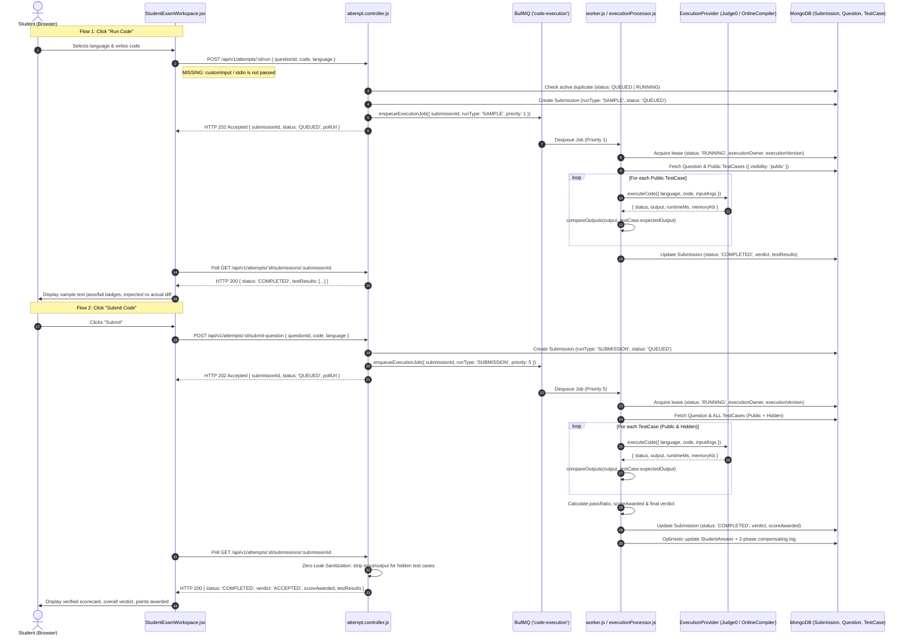

# TESTFORGE: CODE RUNNER IMPLEMENTATION AUDIT (READ-ONLY)

**Document ID:** DOC-ENG-014  
**Version:** 1.0.0  
**Date:** November 13, 2026  
**Status:** Authoritative & Read-Only  
**Roles:** Senior Backend Engineer, Frontend Engineer & Online Judge System Architect  
**Objective:** Ground-Truth Code Runner Audit across Frontend, Backend, Configuration, and OnlineCompiler Integration  

---

## 1. Executive Summary

This read-only audit inspects the complete end-to-end code execution infrastructure of TestForge. It evaluates the current state of code editing, language selection, input handling, execution dispatch, asynchronous queuing, worker evaluation, grading, result polling, and provider integration.

### Authoritative Verification of User Hypotheses:
1. **Editor Surface: Custom `<textarea>`, NOT Monaco Editor:**
   - **CONFIRMED.** Line 1054 of [`client/src/features/student-portal/StudentExamWorkspace.jsx`](file:///d:/TestForge/client/src/features/student-portal/StudentExamWorkspace.jsx) renders a plain HTML `<textarea>` paired with a custom `div` mapping lines to numbers.
   - `@monaco-editor/react` is **NOT installed** in `client/package.json`.
2. **OnlineCompiler Provider: NOT Implemented in Codebase:**
   - **CONFIRMED.** A comprehensive search for `onlinecompiler` across the entire codebase returns **zero matches**.
   - [`server/src/services/execution/providerRegistry.js`](file:///d:/TestForge/server/src/services/execution/providerRegistry.js) registers only three providers: `mock`, `render_sandbox` (Judge0 CE client), and `local` (dev-only host executor).
   - The user previously tested an authenticated OnlineCompiler API via Postman (`POST https://api.onlinecompiler.io/api/run-code-sync/`). To integrate it, a dedicated provider adapter (`OnlineCompilerProvider.js`) must be authored implementing the `ExecutionProvider` interface.
3. **Custom Input Support: MISSING in Frontend and Backend:**
   - **CONFIRMED.** Neither `StudentExamWorkspace.jsx` nor `attempt.controller.js` (`runSampleTests`) supports user-entered custom input or stdin. "Run Code" currently evaluates strictly against pre-seeded public sample test cases stored in MongoDB.

---

## 2. End-to-End Execution Workflows (Trace & Ground Truth)



---

## 3. Detailed Component-by-Component Inspection

### 3.1 Frontend Inspection ([`client/src/features/student-portal/StudentExamWorkspace.jsx`](file:///d:/TestForge/client/src/features/student-portal/StudentExamWorkspace.jsx))

| Component / Subsystem | Current State | Code Location | Status & Detailed Findings |
| :--- | :--- | :--- | :---: |
| **Code Editor** | Custom HTML `<textarea>` | Lines 1045–1062 | **PARTIAL / NOT MONACO**<br>Uses a flexbox container with a line-number gutter `div` and a `<textarea>` with `spellCheck={false}`. Lacks code folding, syntax tokenization, IntelliSense, auto-closing brackets, and snippet support. |
| **Language Selector** | HTML `<select>` dropdown | Lines 981–1000 | **COMPLETE**<br>Supports 4 languages: `javascript` (Node 22), `python` (Python 3.12), `java` (OpenJDK 17), `cpp` (GCC 20). Switching language loads language starter templates (`LANGUAGE_TEMPLATES`). |
| **Custom Input Component** | None | N/A | **MISSING**<br>No UI exists for entering custom standard input (`stdin`). The candidate cannot provide ad-hoc test arguments. |
| **"Run Code" Button** | Action Button (`Play`) | Lines 1021–1029 | **COMPLETE**<br>Triggers `handleRunSampleTests()`. Submits code to `/api/v1/attempts/:id/run` and opens the test drawer. |
| **"Submit Code" Button** | Action Button (`Send`) | Lines 1031–1039 | **COMPLETE**<br>Triggers `handleSubmitQuestion()`. Submits code to `/api/v1/attempts/:id/submit-question` for authoritative grading. |
| **Test Results Drawer** | Resizable Bottom Drawer | Lines 1074–1287 | **COMPLETE**<br>Features tabs for `samples` (Run Code results) and `evaluation` (Submit Code scorecard). Displays expected vs. actual output diffs, error messages, and execution unavailable banners. |
| **Result Polling** | `pollSubmissionStatus()` | Lines 396–420 | **COMPLETE**<br>Polls `GET /attempts/:id/submissions/:id` with exponential backoff starting at 500ms, scaling by 1.3x up to 2000ms, with a 45s hard ceiling. |
| **API Client** | Axios Instance | [`client/src/lib/api.js`](file:///d:/TestForge/client/src/lib/api.js) | **COMPLETE**<br>Configured with baseURL `/api/v1`, 30s timeout, JWT bearer token interceptor, and error normalization. |

### 3.2 Backend Inspection

| Component / Subsystem | File Path | Status & Detailed Findings |
| :--- | :--- | :---: |
| **Execution Provider Interface** | [`server/src/services/execution/ExecutionProvider.interface.js`](file:///d:/TestForge/server/src/services/execution/ExecutionProvider.interface.js) | **COMPLETE**<br>Abstract base class defining `executeCode(params)`, `getCapabilities()`, and `supportsLanguage(lang)`. Expected return format: `{ status, output, error, runtimeMs, compileMs, memoryKb }`. |
| **RenderSandboxProvider** | [`server/src/services/execution/RenderSandboxProvider.js`](file:///d:/TestForge/server/src/services/execution/RenderSandboxProvider.js) | **COMPLETE (Judge0 CE)**<br>Production HTTP client using `undici` to communicate with Judge0 CE over `/submissions`. Handles token polling, timeout margins, status mapping across 14 Judge0 codes, and secret key redaction (`_sanitize`). |
| **Provider Registry** | [`server/src/services/execution/providerRegistry.js`](file:///d:/TestForge/server/src/services/execution/providerRegistry.js) | **COMPLETE**<br>Map-based provider registry. Enforces fail-closed rules (refuses `local` in production). **OnlineCompiler is currently not registered.** |
| **OnlineCompiler Provider Adapter** | N/A | **MISSING**<br>No provider named `onlinecompiler` exists. Must be implemented extending `ExecutionProvider`. |
| **Execution Controllers** | [`server/src/controllers/attempt.controller.js`](file:///d:/TestForge/server/src/controllers/attempt.controller.js) | **COMPLETE**<br>`runSampleTests`: lines 404–489.<br>`submitQuestion`: lines 494–652.<br>`getSubmissionStatus`: lines 657–730.<br>Enforces duplicate job prevention and Zero-Leak hidden test case sanitization. |
| **Execution Routes** | [`server/src/routes/attempt.routes.js`](file:///d:/TestForge/server/src/routes/attempt.routes.js) | **COMPLETE**<br>Protected by `requireAttemptAccess` and rate limiters (`executionRateLimiter`, `submissionRateLimiter`). |
| **Execution Processor** | [`server/src/services/queue/executionProcessor.js`](file:///d:/TestForge/server/src/services/queue/executionProcessor.js) | **COMPLETE**<br>BullMQ job consumer. Handles monotonic lease heartbeats (`renewExecutionLease`), fetches test cases from MongoDB, dispatches to provider via `validateSingleTestCase`, persists verdict, and updates student scores. |
| **Worker Daemon** | [`server/src/worker.js`](file:///d:/TestForge/server/src/worker.js) | **COMPLETE**<br>BullMQ `Worker` listening on `'code-execution'`. Configured with concurrency=5, rate limiter=50/s, and graceful shutdown handlers. |
| **Grading & Comparison** | [`server/src/services/codeRunner.service.js`](file:///d:/TestForge/server/src/services/codeRunner.service.js) | **COMPLETE**<br>`compareOutputs()` handles deep object/array equality, string/number normalization, empty/null equivalence, and Two Sum unordered index pairs. |
| **Execution Recovery** | [`server/src/services/queue/executionRecovery.js`](file:///d:/TestForge/server/src/services/queue/executionRecovery.js) | **COMPLETE**<br>Atomic lease-based reconciler. Distinguishes permanent user errors (WA, TLE, syntax) from infrastructure failures (`INTERNAL_ERROR`), safely requeueing transient failures. |

---

## 4. Configuration & Environment Variables

Inspected [`server/src/config/env.js`](file:///d:/TestForge/server/src/config/env.js) and [`server/.env.example`](file:///d:/TestForge/server/.env.example):

```javascript
// Current Execution Provider Config Schema:
EXECUTION_PROVIDER: Joi.string().valid('mock', 'local', 'render_sandbox').default('mock')
RENDER_SANDBOX_ENDPOINT: Joi.string().uri().optional().allow('')
RENDER_SANDBOX_API_KEY: Joi.string().optional().allow('')
```

### Observations:
1. `EXECUTION_PROVIDER` valid enum currently only allows `'mock'`, `'local'`, and `'render_sandbox'`.
2. To support `onlinecompiler`, the Joi schema in `server/src/config/env.js` must be extended to include `'onlinecompiler'`:
   ```javascript
   EXECUTION_PROVIDER: Joi.string().valid('mock', 'local', 'render_sandbox', 'onlinecompiler')
   ONLINE_COMPILER_ENDPOINT: Joi.string().uri().default('https://api.onlinecompiler.io/api/run-code-sync/')
   ONLINE_COMPILER_API_KEY: Joi.string().optional().allow('')
   ```
3. API credentials must reside strictly on the backend (`server/.env`).

---

## 5. Feature Classification Ledger

| Feature / Requirement | Category | Current Status | Technical Gap / Evidence |
| :--- | :---: | :---: | :--- |
| **Language Selection (C++, Java, Python, JS)** | Frontend | **COMPLETE** | Supported in `StudentExamWorkspace.jsx` and `LANGUAGE_TEMPLATES`. |
| **Monaco Code Editor** | Frontend | **MISSING** | Currently uses HTML `<textarea>`. `@monaco-editor/react` is not installed. |
| **Custom Input Execution** | Full-Stack | **MISSING** | No custom input textarea in UI; `runSampleTests` does not accept `customInput` or `stdin`. |
| **Run Code (Public Sample Tests)** | Full-Stack | **COMPLETE** | Dispatches to BullMQ, evaluates against public sample test cases, displays stdout/diff. |
| **Submit Code (Public + Hidden Tests)** | Full-Stack | **COMPLETE** | Dispatches to BullMQ, evaluates against all test cases, persists score and verdict. |
| **Zero-Leak Hidden Test Protection** | Security | **COMPLETE** | Hidden test inputs, expected outputs, and stdout are completely stripped in controller. |
| **Compilation & Runtime Error Handling** | Backend | **COMPLETE** | Handled in `RenderSandboxProvider` and `validateSingleTestCase`. |
| **Time & Memory Limit Enforcement** | Backend | **COMPLETE** | Handled via provider timeout and memory status mapping. |
| **OnlineCompiler.io Provider Adapter** | Backend | **MISSING** | `OnlineCompilerProvider.js` does not exist; not registered in `providerRegistry.js`. |
| **Language Mappings for OnlineCompiler** | Backend | **MISSING** | Need exact compiler identifiers for Python, C++, Java, and C++ for `api.onlinecompiler.io`. |
| **Automated Runner Tests** | Testing | **COMPLETE (Judge0)** | 54 tests passing across `judge0Integration`, `backendToRunnerIntegration`, `sandboxProvider`, and `executionProvider`. |
| **OnlineCompiler Test Suite** | Testing | **MISSING** | No mock or integration tests exist yet for `OnlineCompilerProvider`. |

---

## 6. Detailed OnlineCompiler.io Integration Specification

Based on the user's verified Postman testing:
- **Target Endpoint:** `POST https://api.onlinecompiler.io/api/run-code-sync/`
- **Protocol:** Synchronous HTTP POST (no polling token required; returns execution response synchronously).
- **Authentication:** `Authorization: Bearer <API_KEY>` (or API Key header as configured).
- **Request Body Contract:**
  ```json
  {
    "compiler": "python3",
    "code": "print('Hello TestForge')",
    "input": "custom input here"
  }
  ```
- **Response Handling Contract:**
  ```json
  {
    "output": "Hello TestForge\n",
    "error": null,
    "status": "success",
    "time": 0.04,
    "memory": 12400
  }
  ```

### Architectural Advantages for TestForge:
1. **Synchronous Execution:** Because `run-code-sync` returns execution output in the HTTP response, the provider does not require polling loops (`GET /submissions/:token`), drastically reducing network round-trips while remaining fully compatible with BullMQ asynchronous worker dispatch!
2. **Zero Privileged Host Overhead:** Eliminates the need for self-hosted privileged Docker containers (resolving SEC-001 for staging and production).

---

## 7. Exact Implementation Plan for Phase 2

When authorized to proceed to Phase 2, the implementation will be executed in 4 structured steps:

### Step 1: Backend OnlineCompiler Adapter (`server/`)
1. Create [`server/src/services/execution/OnlineCompilerProvider.js`](file:///d:/TestForge/server/src/services/execution/OnlineCompilerProvider.js) extending `ExecutionProvider.interface.js`:
   - Compiler identifier mappings:
     - `python` -> `python3` (or target ID)
     - `javascript` -> `nodejs` (or target ID)
     - `java` -> `java` (or target ID)
     - `cpp` -> `cpp` (or target ID)
   - Synchronous `POST https://api.onlinecompiler.io/api/run-code-sync/` using `undici` / `fetch`.
   - Timeout handling and error mapping (Compilation Error, Runtime Error, Timeout, Output Mismatch).
   - Secret key redaction (`_sanitize`).
2. Update [`server/src/services/execution/providerRegistry.js`](file:///d:/TestForge/server/src/services/execution/providerRegistry.js):
   - Register `'onlinecompiler'`.
3. Update [`server/src/config/env.js`](file:///d:/TestForge/server/src/config/env.js):
   - Add `'onlinecompiler'` to allowed `EXECUTION_PROVIDER` values.
   - Add `ONLINE_COMPILER_ENDPOINT` and `ONLINE_COMPILER_API_KEY`.
4. Author automated test suite [`server/tests/onlineCompilerProvider.test.js`](file:///d:/TestForge/server/tests/onlineCompilerProvider.test.js) with mocked HTTP responses covering all 4 languages and error verdicts.

### Step 2: Custom Input Support (Backend & Queue)
1. Update `server/src/controllers/attempt.controller.js` (`runSampleTests`):
   - Accept optional `customInput` in request body.
   - If `customInput` is provided, create an ephemeral custom test case in the execution payload.
2. Update `server/src/services/queue/executionProcessor.js`:
   - If submission has `customInput`, evaluate student code against the custom input and return stdout/stderr without comparing against expected outputs.

### Step 3: Monaco Code Editor & Custom Input UI (Frontend)
1. Install `@monaco-editor/react` in `client/package.json`.
2. Update [`client/src/features/student-portal/StudentExamWorkspace.jsx`](file:///d:/TestForge/client/src/features/student-portal/StudentExamWorkspace.jsx):
   - Replace `<textarea>` with `<Editor language={monacoLanguage} value={currentCode} theme="vs-dark" />`.
   - Add a "Custom Input" toggle checkbox and `<textarea>` in the test drawer.
   - Pass `customInput` in `api.post('/attempts/:id/run')`.
   - Render actual `stdout`, `stderr`, runtime, and memory metrics in the results drawer.

### Step 4: Verification & Regression Gate
1. Run backend tests: `cd server; npm test` (all suites must pass).
2. Run frontend build: `cd client; npm run build` (must compile clean).
3. Verify all 4 languages: Python, C++, Java, JavaScript.
