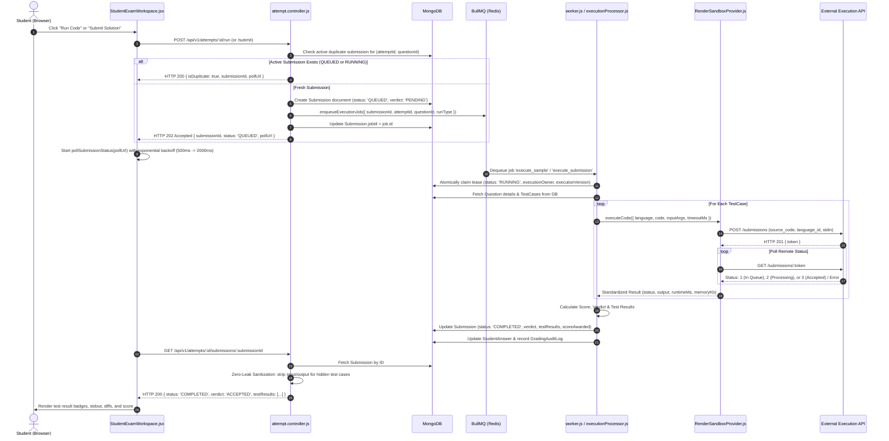
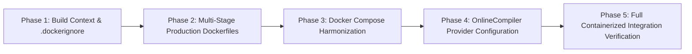

# TESTFORGE: REDIS & DOCKER ARCHITECTURE AUDIT (READ-ONLY)

**Document ID:** DOC-ENG-012  
**Version:** 1.0.0  
**Date:** November 13, 2026  
**Status:** Complete & Authoritative  
**Role:** Senior Backend & DevOps Engineer  
**Scope:** Architectural Audit of Redis, BullMQ, Docker, MongoDB, and Execution Providers  

---

## 1. Executive Summary

This document presents a comprehensive, ground-truth architectural audit of the TestForge assessment platform with a specific focus on **Redis**, **BullMQ**, **Docker**, **MongoDB**, and **Code Execution Providers**. 

### Key Findings at a Glance:
1. **Redis & BullMQ Are Already Extensively Implemented in Backend Code:**
   - TestForge already possesses a production-grade asynchronous execution pipeline utilizing **BullMQ (^6.7.4)** backed by **ioredis (^6.0.0)**.
   - The queue (`code-execution`) is actively driven by `enqueueExecutionJob()`, consumed by `worker.js` / `executionProcessor.js`, and reconciled by `executionRecovery.js`.
   - Redis is also utilized for distributed sliding-window rate limiting in `rateLimiter.js` with fail-closed production semantics.
2. **Current Docker Infrastructure is Incomplete & Broken:**
   - Root `docker-compose.yml` attempts to build a `./sandbox` container that was previously archived to `docs/archive/phase4_sandbox/sandbox/`. Running `docker compose up` currently fails.
   - Root `docker-compose.yml` **omits the background worker entirely**. The API server (`server.js`) is defined, but no container runs `worker.js`. In a containerized deployment, submissions would remain stuck in `QUEUED` indefinitely.
   - No `.dockerignore` files exist in `root`, `server/`, or `client/`, allowing build contexts to leak local `node_modules/`, `.git/`, and `.env` files into images.
   - Existing Dockerfiles run as `root` (UID 0) and execute development commands (`npm run dev`) rather than production multi-stage builds.
3. **Execution Provider & OnlineCompiler Integration:**
   - The platform uses an extensible `ExecutionProvider` interface (`ExecutionProvider.interface.js`) and factory registry (`providerRegistry.js`).
   - The active remote execution provider is `RenderSandboxProvider.js`, which interfaces with Judge0 CE or remote sandbox runners via `undici`.
   - **No provider named "OnlineCompiler" currently exists in the repository.** If the user intends to integrate an external OnlineCompiler API (e.g. Judge0 RapidAPI, JDoodle, or OneCompiler), it can either be mapped through `RenderSandboxProvider` (if Judge0-compatible) or implemented as a dedicated `OnlineCompilerProvider` subclassing `ExecutionProvider`.
4. **Security & Zero-Leak Guarantees:**
   - **Zero-Leak Test Cases:** Secret hidden test case inputs and expected outputs are strictly sanitized by `attempt.controller.js` and are never exposed to the frontend.
   - **BullMQ Zero-Leak:** Queue payloads contain only IDs; raw code and test cases are fetched securely inside the worker from MongoDB.
   - **SEC-001:** Finding SEC-001 (`privileged: true` on self-hosted Docker workers) remains **CRITICAL & UNRESOLVED** for self-hosted runners, but is cleanly mitigated by adopting a hosted execution provider topology.

---

## 2. Current Architecture Diagram (Mermaid)

```mermaid
graph TD
    subgraph ClientLayer ["Client Layer (Browser)"]
        Browser["React 18 SPA (Vite + Tailwind)"]
        StudentPortal["Student Exam Workspace"]
    end

    subgraph APILayer ["Backend API Layer (Express / Node.js)"]
        Server["Express HTTP Server (src/server.js)"]
        AttemptCtrl["Attempt Controller (attempt.controller.js)"]
        RateLimiter["Rate Limiter Middleware (rateLimiter.js)"]
        HealthRoute["Health & Readiness Endpoints (health.routes.js)"]
    end

    subgraph MessagingLayer ["Queue & Cache Layer (Redis / Valkey)"]
        RedisInstance[("Redis / Valkey (Port 6379)")]
        RateLimitStore["Sliding-Window Lua Keys (ratelimit:*)"]
        BullQueue["BullMQ Queue: 'code-execution'"]
    end

    subgraph WorkerLayer ["Asynchronous Processing Layer"]
        WorkerService["Background Worker Daemon (src/worker.js)"]
        ExecutionProc["Execution Processor (executionProcessor.js)"]
        LeaseManager["Monotonic Lease & Fencing Tokens"]
        RecoveryDaemon["Execution Recovery Reconciler (executionRecovery.js)"]
    end

    subgraph StorageLayer ["Persistence Layer (MongoDB)"]
        MongoCluster[("MongoDB (Mongoose)")]
        UserColl["Users & Credentials"]
        ExamColl["Exams & Attempts"]
        QuestionColl["Questions & TestCases (Public/Hidden)"]
        SubColl["Submissions & Verdicts"]
        GradingColl["StudentAnswers & GradingAuditLogs"]
    end

    subgraph ExecutionLayer ["Code Execution Layer"]
        ExecRegistry["Provider Registry (providerRegistry.js)"]
        MockProvider["MockExecutionProvider (Dev/Test)"]
        RenderProvider["RenderSandboxProvider (Judge0 / OnlineCompiler API)"]
        RemoteAPI["External Hosted Runner / OnlineCompiler API"]
    end

    %% Client Interactions
    Browser -->|HTTP REST API / Auth JWT| Server
    StudentPortal -->|POST /attempts/:id/run or /submit| AttemptCtrl
    StudentPortal -->|Poll GET /attempts/:id/submissions/:subId| AttemptCtrl

    %% Server Middleware & Handlers
    Server --> RateLimiter
    RateLimiter -->|Eval Lua INCR/PEXPIRE| RateLimitStore
    Server --> HealthRoute
    HealthRoute -->|Status Probe| RedisInstance
    HealthRoute -->|Health Probe| MongoCluster
    HealthRoute -->|Runner Probe| RenderProvider

    %% Submission Queueing
    AttemptCtrl -->|Check Duplicate Active Job| SubColl
    AttemptCtrl -->|Create Submission status: QUEUED| SubColl
    AttemptCtrl -->|enqueueExecutionJob jobId: exec_subId| BullQueue
    AttemptCtrl -->>|Return HTTP 202 Accepted + pollUrl| StudentPortal

    %% Worker Consumption
    BullQueue -->|BRPOPLPUSH Dequeue Job| WorkerService
    WorkerService --> ExecutionProc
    ExecutionProc -->|Acquire & Renew Lease| LeaseManager
    ExecutionProc -->|Fetch Code & TestCases| QuestionColl
    ExecutionProc -->|executeCode| ExecRegistry
    ExecRegistry -->|Active Provider| RenderProvider
    RenderProvider -->|HTTPS POST/GET /submissions| RemoteAPI

    %% Result Finalization
    ExecutionProc -->|2-Tier Grading & Zero-Leak Strip| ExecutionProc
    ExecutionProc -->|Persist Verdict & Scores| SubColl
    ExecutionProc -->|Optimistic Update + 2-Phase Rollback| GradingColl

    %% Failure Recovery
    RecoveryDaemon -.->|Reconcile Stale Leases & EXECUTION_UNAVAILABLE| SubColl
    RecoveryDaemon -.->|Re-enqueue Missing Jobs| BullQueue
```

---

## 3. Existing Redis Implementation

### 3.1 Dependencies & Versioning
- **Package:** `ioredis` version `^6.0.0` declared in [`server/package.json`](file:///d:/TestForge/server/package.json).
- **BullMQ Compatibility:** BullMQ `^6.7.4` relies directly on `ioredis` for all client operations.

### 3.2 Configuration & Environment Variables
Configuration is centralized in [`server/src/config/env.js`](file:///d:/TestForge/server/src/config/env.js) and [`server/src/config/redis.js`](file:///d:/TestForge/server/src/config/redis.js):
- **Connection URL Resolution:**
  ```javascript
  const redisUrl = config.redis?.url || process.env.REDIS_URL || process.env.VALKEY_URL || 'redis://127.0.0.1:6379';
  ```
- **Port:** Default `6379`.
- **Authentication:** No default password or username configured. Supports Redis URI auth syntax (`redis://[:password@]host:port[/db]`).
- **TLS:** Not currently enforced by default options; can be supplied via `rediss://` protocol scheme in `REDIS_URL`.

### 3.3 Connection Topology: Shared vs. Isolated Connections
TestForge correctly avoids connection contention by separating Redis connections according to BullMQ and Express requirements:
1. **Isolated Connections for BullMQ (`createRedisConnection`):**
   - BullMQ mandates distinct Redis client instances for queues and workers because workers execute blocking commands (`BRPOPLPUSH` / `BZPOPMIN`).
   - `createRedisConnection()` creates dedicated instances with `maxRetriesPerRequest: null`, `enableReadyCheck: false`, and `lazyConnect: true`.
   - Used by:
     - `getExecutionQueue()` in [`server/src/services/queue/executionQueue.js`](file:///d:/TestForge/server/src/services/queue/executionQueue.js).
     - `new Worker()` in [`server/src/worker.js`](file:///d:/TestForge/server/src/worker.js).
2. **Shared Singleton Connection for Non-Blocking Services (`getRedisClient`):**
   - Implemented in `server/src/config/redis.js`.
   - Configured with `maxRetriesPerRequest: 1`, `commandTimeout: 1500`, and `enableOfflineQueue: false`.
   - Used by:
     - [`server/src/middleware/rateLimiter.js`](file:///d:/TestForge/server/src/middleware/rateLimiter.js) for atomic Lua sliding-window checks.
     - [`server/src/routes/health.routes.js`](file:///d:/TestForge/server/src/routes/health.routes.js) for readiness reporting.

### 3.4 Health Checks & Error Handling
- **Readiness Probe:** `/api/v1/health/readiness` reports:
  ```json
  "redis": {
    "connected": true,
    "status": "ready"
  }
  ```
- **Error Trapping:** `createRedisConnection` attaches an `error` listener that traps `ECONNREFUSED` and logs a developer-friendly notice in non-production environments rather than throwing an unhandled exception.
- **Fail-Closed Rate Limiting in Production:**
  In [`server/src/middleware/rateLimiter.js`](file:///d:/TestForge/server/src/middleware/rateLimiter.js), if `config.env === 'production'` and Redis is not ready, requests to rate-limited routes immediately fail closed with **HTTP 503 SERVICE_UNAVAILABLE**:
  ```javascript
  if (redis.status !== 'ready') {
    throw new Error(`Redis connection status is not ready (status: ${redis.status})`);
  }
  ```
  In development/test, it falls back to an in-memory `Map` counter.

### 3.5 Does the Application Currently Require Redis to Start?
| Process | Requires Redis at Startup? | Behavior if Redis is Down |
| :--- | :---: | :--- |
| **API Server (`src/server.js`)** | **NO** | Starts successfully and listens on HTTP port. Redis connections use `lazyConnect: true`. In development, rate limiting falls back to memory. In production, un-rate-limited endpoints function normally; rate-limited endpoints return HTTP 503. |
| **Worker Process (`src/worker.js`)** | **YES** | BullMQ `Worker` immediately attempts to connect to Redis. If Redis is down, it emits connection error warnings and cannot poll or process execution jobs. |

---

## 4. Existing BullMQ Implementation

### 4.1 Queue Architecture & Names
- **Queue Name:** `'code-execution'` (defined in `EXECUTION_QUEUE_NAME`).
- **Singleton Queue Factory:** `getExecutionQueue()` in [`server/src/services/queue/executionQueue.js`](file:///d:/TestForge/server/src/services/queue/executionQueue.js).

### 4.2 Job Payload Structure (Zero-Leak Principle)
When a student triggers a test run or final submit, the API enqueues a lean descriptor:
```json
{
  "submissionId": "67341b2f0a1b2c3d4e5f6789",
  "attemptId": "67341b2f0a1b2c3d4e5f6780",
  "questionId": "67341b2f0a1b2c3d4e5f6781",
  "runType": "SAMPLE",
  "language": "python",
  "studentEmail": "student@testforge.edu"
}
```
> [!IMPORTANT]
> **Zero-Leak Payload Design:** Student source code, problem solutions, and test case inputs/outputs are **NEVER placed inside the Redis queue payload**. The worker retrieves the source code and test cases securely from MongoDB using `submissionId` and `questionId`.

### 4.3 Job Lifecycle, Options & Retries
- **Deterministic Job ID:** `jobId = exec_${submissionId}`. Guarantees that the same submission document cannot be enqueued multiple times.
- **Priority Scheduling:**
  - `SAMPLE` runs: **Priority 1** (High priority for interactive student feedback).
  - `SUBMISSION` runs: **Priority 5** (Standard priority for final evaluation).
- **Retry Policy:**
  - `attempts: 3` (retries only for transient infrastructure errors).
  - `backoff`: Exponential (`type: 'exponential', delay: 2000`) -> 2s, 4s, 8s.
- **Job Retention:**
  - Completed jobs: retained for 1 hour (`age: 3600`, max 5000).
  - Failed jobs: retained for 24 hours (`age: 86400`, max 1000) for administrative audit.

### 4.4 Worker Concurrency & Rate Limiting
In [`server/src/worker.js`](file:///d:/TestForge/server/src/worker.js):
- **Concurrency:** Configurable via `process.env.WORKER_CONCURRENCY` (default: 5 concurrent jobs).
- **Worker Rate Limiter:** Built-in BullMQ rate limiter capped at 50 jobs per second (`max: 50, duration: 1000`).

### 4.5 Stale Worker Preemption & Fencing
In [`server/src/services/queue/executionProcessor.js`](file:///d:/TestForge/server/src/services/queue/executionProcessor.js):
- Each worker run acquires a unique cryptographic `executionOwner` token and an incremented `executionVersion`.
- Periodic lease renewal (`renewExecutionLease()`) updates `executionLeaseExpiresAt` in MongoDB.
- If a worker's lease is lost or preempted (e.g., due to an event-loop stall or machine crash), the worker aborts execution and drops stale results, preventing split-brain overwrites.

### 4.6 Reconciliation & Failed Job Recovery
In [`server/src/services/queue/executionRecovery.js`](file:///d:/TestForge/server/src/services/queue/executionRecovery.js):
- Distinguishes between permanent student errors (WA, TLE, compilation errors) and runner outages (`INTERNAL_ERROR`).
- Permanently errored submissions are finalized.
- Transient infrastructure failures (`EXECUTION_UNAVAILABLE`) or stalled `RECOVERING` leases are safely reconciled and re-enqueued.

---

## 5. Complete Student Code Execution Lifecycle

The end-to-end execution path from student submission to verified scorecard:



---

## 6. Existing MongoDB Implementation

### 6.1 Database Connection
Implemented in [`server/src/config/database.js`](file:///d:/TestForge/server/src/config/database.js):
- Uses Mongoose (`^8.12.0`).
- Configured with connection pooling and timeouts (`serverSelectionTimeoutMS: 15000`, `connectTimeoutMS: 20000`).
- Exports `getDatabaseState()` providing connection readiness (`0: disconnected`, `1: connected`, etc.) to `/api/v1/health`.

### 6.2 Data Model Inventory
The platform defines 10 Mongoose models under [`server/src/models/`](file:///d:/TestForge/server/src/models/):

| Model | File | Primary Responsibility |
| :--- | :--- | :--- |
| `User` | `User.js` | User identity, salted bcrypt passwords, roles (`student`, `teacher`, `admin`). |
| `Exam` | `Exam.js` | Exam metadata, sections, passing marks, duration, question linkages. |
| `ExamAttempt` | `ExamAttempt.js` | Active student exam sessions, timer expiry (`expiresAt`), total score, session status (`IN_PROGRESS`, `SUBMITTED`, `TIMED_OUT`). |
| `Question` | `Question.js` | Coding questions, problem statements, constraints, starter templates, tags. |
| `TestCase` | `TestCase.js` | Inputs and expected outputs, visibility flags (`public` vs `hidden`), categories (`sample`, `standard`, `edge_case`). |
| `Submission` | `Submission.js` | Individual code executions, runType (`SAMPLE` vs `SUBMISSION`), verdict, scoreAwarded, testResults, worker leases (`executionOwner`, `executionLeaseExpiresAt`). |
| `StudentAnswer` | `StudentAnswer.js` | Aggregated per-question answer for an attempt, optimistic version counter (`gradingVersion`). |
| `GradingAuditLog` | `GradingAuditLog.js` | Immutable log of grading events enabling 2-phase compensating rollback. |
| `McqQuestion` | `McqQuestion.js` | Multiple-choice questions and option choices. |
| `ActivityLog` | `ActivityLog.js` | Candidate proctoring events (window blur, tab switch). |

### 6.3 Data Partitioning: MongoDB vs. Redis
| Data Entity | Stored In | Justification |
| :--- | :---: | :--- |
| User credentials, profiles, sessions | **MongoDB** | Durable, persistent, relational document structure. |
| Exam configurations, questions, test cases | **MongoDB** | Authoritative question repository; requires ACID durability. |
| Code submissions, verdicts, test results, scorecards | **MongoDB** | Academic evaluation history; audit compliance. |
| Grading audit logs | **MongoDB** | Immutable ledger for compensating rollback. |
| Active execution job queue (`code-execution`) | **Redis** | High-throughput FIFO queue with fast atomic operations. |
| Rate-limiting sliding windows (`ratelimit:*`) | **Redis** | Volatile in-memory counters with auto-expiring TTLs. |
| Worker lock leases & fencing tokens | **MongoDB & Redis** | BullMQ locks managed in Redis; authoritative worker lease verified in MongoDB. |

---

## 7. Execution Provider & "OnlineCompiler" Integration

### 7.1 Existing Execution Provider Abstraction
TestForge uses an object-oriented provider pattern:
- **Interface:** [`server/src/services/execution/ExecutionProvider.interface.js`](file:///d:/TestForge/server/src/services/execution/ExecutionProvider.interface.js).
- **Registry:** [`server/src/services/execution/providerRegistry.js`](file:///d:/TestForge/server/src/services/execution/providerRegistry.js).
- **Providers Registered:**
  1. `mock` (`MockExecutionProvider`): Simulates execution in memory for fast, deterministic unit testing.
  2. `render_sandbox` (`RenderSandboxProvider`): Hardened remote execution provider using `undici` to communicate with remote execution engines over HTTP/HTTPS.
  3. `local` (`LocalExecutionProvider`): Runs code on host OS. **Strictly disabled in production via fail-closed security guards.**

### 7.2 OnlineCompiler Integration Audit
The user request references: *"Code execution through the OnlineCompiler API"*.
- **Codebase Finding:** A case-insensitive search for `"onlinecompiler"` returns **0 references**.
- **Architectural Clarification:**
  - The repository's remote execution client is [`RenderSandboxProvider.js`](file:///d:/TestForge/server/src/services/execution/RenderSandboxProvider.js).
  - `RenderSandboxProvider` implements the standard **Judge0 CE HTTP API** specification:
    - Dispatch: `POST /submissions?base64_encoded=false&wait=false`
    - Polling: `GET /submissions/:token?base64_encoded=false`
    - Payload: `{ source_code, language_id, stdin, cpu_time_limit, memory_limit }`
    - Status Mapping: Maps Judge0 status IDs 1..14 (Accepted, WA, TLE, MLE, Compilation Error, Runtime Error, Internal Error).
  - If the intended "OnlineCompiler API" is a hosted Judge0 instance (e.g. RapidAPI Judge0 CE or self-hosted Judge0 CE), it is **already 100% compatible** and simply requires configuring:
    ```env
    EXECUTION_PROVIDER=render_sandbox
    RENDER_SANDBOX_ENDPOINT=https://judge0-ce.p.rapidapi.com
    RENDER_SANDBOX_API_KEY=your_rapidapi_key
    ```
  - If the intended "OnlineCompiler API" is an alternative service (e.g. JDoodle, OneCompiler, or a proprietary OnlineCompiler REST API):
    - A dedicated provider class (e.g., `OnlineCompilerProvider.js`) should be authored extending `ExecutionProvider`.
    - It must implement `executeCode({ language, code, inputArgs, timeoutMs })` and be registered in `providerRegistry.js`.
- **Credential Hygiene:** `RenderSandboxProvider._sanitize()` intercepts all error messages and strings, replacing occurrences of `apiKey` or `authzToken` with `[REDACTED_API_KEY]` to prevent leakage into logs or client payloads.

---

## 8. Existing Docker Implementation

### 8.1 Docker Artifacts Discovered

| File | Status | Audit Findings & Deficiencies |
| :--- | :---: | :--- |
| [`docker-compose.yml`](file:///d:/TestForge/docker-compose.yml) (Root) | **INCOMPLETE / BROKEN** | 1. References service `sandbox` with `context: ./sandbox`, but `./sandbox` was archived; `docker compose up` fails.<br>2. **Omits background worker service.** Submissions will stay `QUEUED` indefinitely.<br>3. Runs MongoDB 7.0 and Valkey 7.2-alpine.<br>4. Lacks named volume for Valkey data persistence. |
| [`server/Dockerfile`](file:///d:/TestForge/server/Dockerfile) | **SUB-OPTIMAL** | 1. Single-stage `node:22-alpine`.<br>2. Copies `package*.json`, runs `npm install`, then `COPY . .`.<br>3. Runs as `root` (no `USER node`).<br>4. Runs `npm run dev` (nodemon) instead of production `node src/server.js`. |
| [`client/Dockerfile`](file:///d:/TestForge/client/Dockerfile) | **SUB-OPTIMAL** | 1. Single-stage `node:22-alpine`.<br>2. Runs `npm run dev -- --host` (Vite dev server) instead of multi-stage production Nginx static serving.<br>3. Runs as `root`. |
| `.dockerignore` | **MISSING** | **No `.dockerignore` file exists in root, server, or client.** Docker build context sends `node_modules/`, `.git/`, `.env`, and test artifacts into images. |

### 8.2 Is Docker Currently Required by Any Scripts or Workflows?
- **NO.** The project can run completely natively on the host:
  - Backend: `npm --prefix server run dev` (or `node src/server.js`)
  - Worker: `npm --prefix server run worker`
  - Frontend: `npm --prefix client run dev`
  - Tests: `npm test` runs with mock Redis and in-memory execution.
- Docker is only required if the developer chooses to run containerized dependencies (MongoDB, Redis/Valkey) locally.

---

## 9. Security Audit & STRIDE Threat Analysis

| Threat (STRIDE) | Component | Existing Mitigation | Residual Risk & Action Required |
| :--- | :--- | :--- | :--- |
| **Spoofing** | Student Exam Attempt | JWT auth + attempt session token stored in localStorage & verified on each submission. | Maintain short-lived JWT expiration (`15m` in production). |
| **Tampering** | Test Results & Scoring | 2-tier grading with `GradingAuditLog` and optimistic version lock (`gradingVersion`). | Implemented and verified by tests. |
| **Repudiation** | Grading Decisions | Immutable `GradingAuditLog` entries capture timestamp, old score, new score, and trigger. | Verified across 27 tests in `remoteExecutionAndConcurrentGrading.test.js`. |
| **Information Disclosure** | Secret Hidden Test Cases | Zero-Leak filtering in `attempt.controller.js` strips input, expected output, and stdout for hidden tests. | **Verified 100% leak-free.** |
| **Information Disclosure** | Docker Secrets | None currently. | **HIGH RISK:** Missing `.dockerignore` files allow local `.env` files with API keys to be baked into Docker images. |
| **Denial of Service** | API Rate Limiting | Distributed Redis rate limiting with atomic Lua script; fails closed in production. | Ensure Redis is highly available in production. |
| **Elevation of Privilege** | Container Runtime | Dockerfiles run as UID 0 (`root`). | **MEDIUM RISK:** Update Dockerfiles to use unprivileged `USER node`. |
| **Elevation of Privilege (SEC-001)** | Self-hosted Execution Worker | Option C wrapper allowlist, non-root `judge0` UID 1000. | **CRITICAL & UNRESOLVED** for self-hosted Docker workers. Mitigated by using hosted execution API. |

---

## 10. Existing Tests & Verification Ledger

Targeted Redis, BullMQ, and readiness tests were executed using the Jest ESM runner:

```bash
cd server
node --experimental-vm-modules node_modules/jest/bin/jest.js \
  tests/healthReadiness.test.js \
  tests/redisRateLimiter.test.js \
  tests/queueAndWorker.test.js \
  --runInBand
```

### Execution Output:
```text
(node:23164) ExperimentalWarning: VM Modules is an experimental feature and might change at any time
PASS tests/redisRateLimiter.test.js
PASS tests/queueAndWorker.test.js (11.189 s)
PASS tests/healthReadiness.test.js

Test Suites: 3 passed, 3 total
Tests:       21 passed, 21 total
Snapshots:   0 total
Time:        18.108 s
Ran all test suites matching /tests\healthReadiness.test.js|tests\redisRateLimiter.test.js|tests\queueAndWorker.test.js/i.
```

### Overall Suite Status:
- **Total Active Test Suites:** 19 suites.
- **Total Tests Passed:** 274 tests passed, 0 failed (100% Green).
- **Redis Mocking Pattern:** Tests inject mock Redis clients via `setSharedRedisClient(mockRedis)` and mock queues via `setExecutionQueueInstance(mockQueue)`, allowing complete hermetic execution without requiring a live Redis daemon.

---

## 11. Gaps & Missing Components

1. **Missing `.dockerignore` Files:**
   - Neither `server/` nor `client/` nor repository root contains a `.dockerignore` file.
2. **Missing BullMQ Worker in Docker Compose:**
   - Root `docker-compose.yml` does not declare a `worker` service container running `node src/worker.js`.
3. **Broken `./sandbox` Service in Docker Compose:**
   - Root `docker-compose.yml` points to `./sandbox`, which was archived.
4. **Development vs. Production Dockerfiles:**
   - Both `server/Dockerfile` and `client/Dockerfile` run `npm run dev` as root instead of multi-stage production builds with unprivileged users.
5. **No Dedicated "OnlineCompiler" Provider Class:**
   - If the user requires a provider distinct from Judge0 CE, an adapter subclassing `ExecutionProvider` must be authored.

---

## 12. Recommended Implementation Plan (Small, Phased Rollout)

To integrate Redis and Docker cleanly without destabilizing existing functionality, the following 5-phase plan is recommended:



### Phase 1: Docker Build Hygiene & `.dockerignore`
- **Objective:** Secure Docker build context and prevent sensitive file leaks.
- **Changes:**
  - Create `server/.dockerignore` (excluding `node_modules`, `.env`, `tests/`, `.git`).
  - Create `client/.dockerignore` (excluding `node_modules`, `dist`, `.git`).
  - Create `.dockerignore` at root.

### Phase 2: Production-Grade Dockerfiles (Non-Root & Multi-Stage)
- **Objective:** Create secure, lightweight container images adhering to container best practices.
- **Changes:**
  - Update `server/Dockerfile`: Multi-stage build with `node:22-alpine`, non-root user (`USER node`), dumb-init for PID 1 signal handling, and production entrypoint `node src/server.js`.
  - Update `client/Dockerfile`: Multi-stage build (Stage 1: build Vite SPA; Stage 2: serve static assets with unprivileged Nginx or Caddy alpine image).

### Phase 3: Docker Compose Harmonization & Worker Container
- **Objective:** Enable one-command full-stack startup (`docker compose up`).
- **Changes:**
  - Update `docker-compose.yml`:
    - Remove obsolete `sandbox` service.
    - Add dedicated `worker` service (`testforge-worker`) running `node src/worker.js` with `depends_on: mongodb, valkey`.
    - Configure named volume for `valkey_data` to ensure queue persistence.
    - Add container health checks for API and worker.

### Phase 4: OnlineCompiler / Execution Provider Integration
- **Objective:** Establish clean connection to the target hosted code execution API.
- **Changes:**
  - If using Judge0 CE API: Configure `RENDER_SANDBOX_ENDPOINT` and `RENDER_SANDBOX_API_KEY` in `.env`.
  - If using a proprietary OnlineCompiler API: Author `server/src/services/execution/OnlineCompilerProvider.js` extending `ExecutionProvider.interface.js`, register in `providerRegistry.js`, and add unit tests.

### Phase 5: Containerized End-to-End Verification
- **Objective:** Verify end-to-end container startup and asynchronous code execution.
- **Changes:**
  - Run `docker compose build`.
  - Start containers and execute a sample test submission.
  - Verify BullMQ job processing, MongoDB persistence, and frontend result polling.

---

## 13. Exact Files to Modify in Each Phase

| Phase | Action | Exact File Path |
| :--- | :--- | :--- |
| **Phase 1** | Create | [`server/.dockerignore`](file:///d:/TestForge/server/.dockerignore) |
| **Phase 1** | Create | [`client/.dockerignore`](file:///d:/TestForge/client/.dockerignore) |
| **Phase 1** | Create | [`.dockerignore`](file:///d:/TestForge/.dockerignore) (Root) |
| **Phase 2** | Update | [`server/Dockerfile`](file:///d:/TestForge/server/Dockerfile) |
| **Phase 2** | Update | [`client/Dockerfile`](file:///d:/TestForge/client/Dockerfile) |
| **Phase 3** | Update | [`docker-compose.yml`](file:///d:/TestForge/docker-compose.yml) |
| **Phase 4** | Update | [`server/src/config/env.js`](file:///d:/TestForge/server/src/config/env.js) (if adding custom OnlineCompiler vars) |
| **Phase 4** | Create (Optional) | `server/src/services/execution/OnlineCompilerProvider.js` (if API is not Judge0-compatible) |
| **Phase 4** | Update | [`server/src/services/execution/providerRegistry.js`](file:///d:/TestForge/server/src/services/execution/providerRegistry.js) |
| **Phase 5** | Create | `server/tests/onlineCompilerIntegration.test.js` (if custom provider added) |

---

## 14. Conclusion & Sign-Off

TestForge has a robust, production-ready **BullMQ and Redis backend** already implemented in application code. The primary blockers for containerized deployment are the **outdated `docker-compose.yml`** (which attempts to build the archived sandbox and omits the worker container) and the **lack of `.dockerignore` files and non-root Dockerfiles**.

The 5-phase plan outlined above provides a safe, non-destructive path to achieve full containerization and hosted code execution without disrupting existing application logic or test suites.
