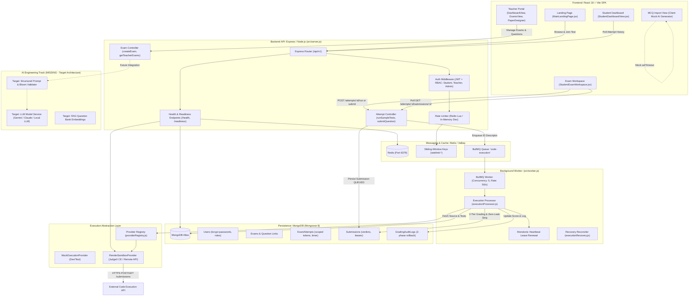
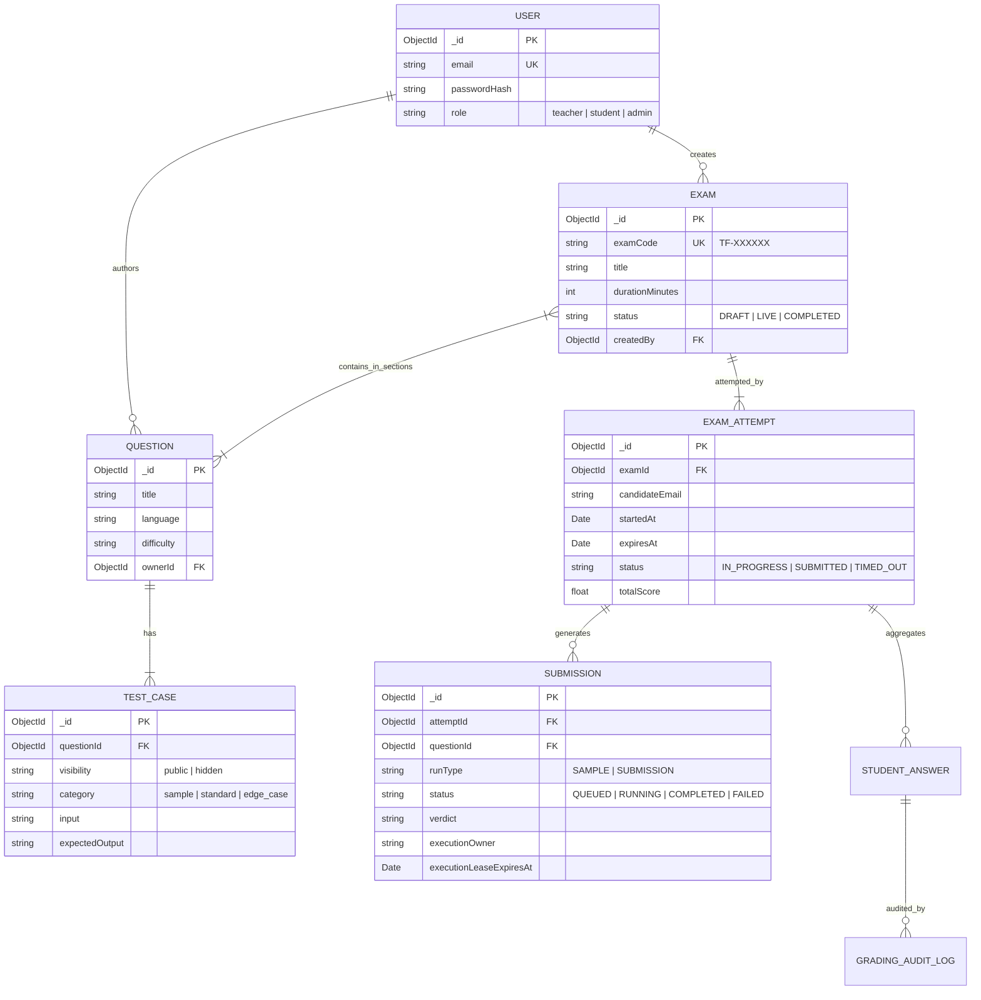
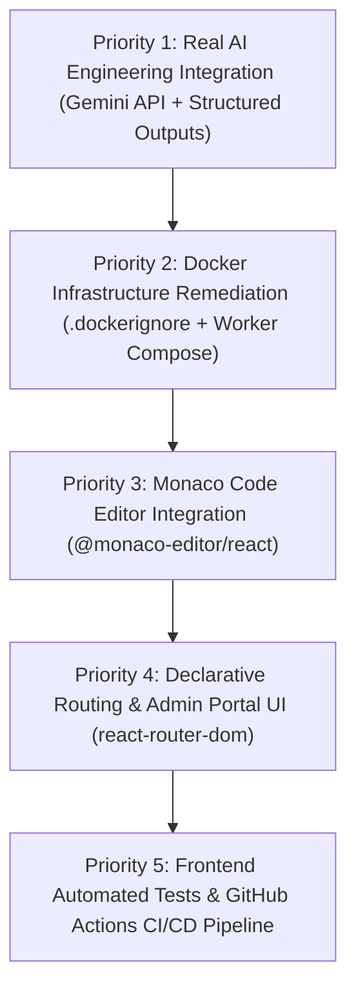

# TESTFORGE: COMPLETE FULL STACK AI ENGINEERING PROJECT AUDIT

**Document ID:** DOC-ENG-013  
**Version:** 1.0.0  
**Date:** November 13, 2026  
**Status:** Complete & Authoritative  
**Roles:** Senior Full-Stack Architect, AI Engineer, Security Engineer & Technical Reviewer  
**Scope:** Full-Stack Architecture, AI Systems, Code Execution, Database, Security, Testing & DevOps  

---

## 1. Executive Summary

This master architecture audit evaluates the entire TestForge repository to establish a definitive baseline for evolving the platform into an enterprise-grade **Full Stack AI Engineering** portfolio project.

TestForge already contains advanced full-stack capabilities:
- An asynchronous code execution queue with **BullMQ** and **Redis** featuring monotonic worker leases, deterministic job IDs, and cryptographic fencing.
- An extensible **ExecutionProvider** abstraction with a verified **Judge0 CE** HTTP integration.
- Strict **Zero-Leak security** ensuring hidden test case inputs and outputs are never leaked to client responses.
- Robust **2-tier grading** with optimistic concurrency control and 2-phase compensating rollback.
- A comprehensive **19-suite backend regression test harness** (274 tests passed, 100% Green).

However, rigorous inspection reveals critical architectural gaps that currently prevent the project from qualifying as a true AI Engineering platform:
1. **AI Features Are Pure Client-Side Mocks:** The "AI Question Generator" in [`client/src/features/mcq-import/McqImportView.jsx`](file:///d:/TestForge/client/src/features/mcq-import/McqImportView.jsx) is an artificial `setTimeout(1400)` delivering hardcoded string templates. No model-serving endpoint, external LLM SDK, or Python ML service is implemented.
2. **Missing Monaco Editor:** Despite architectural documentation referencing Monaco, the student examination workspace uses a plain HTML `<textarea>` with a manual line-number gutter.
3. **Broken & Incomplete Docker Infrastructure:** Root `docker-compose.yml` attempts to build an archived `./sandbox` directory and **omits the background worker entirely**. Furthermore, zero `.dockerignore` files exist, and images run as `root`.
4. **Frontend Architecture Lacks Declarative Routing & Testing:** The client uses a monolithic `activeTab` state switcher instead of `react-router-dom` URL routes, and contains **zero automated tests** and no CI/CD pipeline.
5. **Admin Portal Is Missing in Frontend:** While the backend provides administrative routes and RBAC permissions, there is no corresponding frontend admin console.

---

## 2. Actual System Architecture Diagram



---

## 3. Frontend Feature Matrix

| Feature / Module | Component File | Classification | Ground-Truth Inspection Findings |
| :--- | :--- | :---: | :--- |
| **Main Landing Page** | [`client/src/features/landing/MainLandingPage.jsx`](file:///d:/TestForge/client/src/features/landing/MainLandingPage.jsx) | **COMPLETE** | High-performance landing page featuring Bento grid, interactive hero scroll, FAQ accordion, Three.js ASMR canvas, and access code entry. |
| **Student Auth Flow** | [`client/src/features/auth/AuthPage.jsx`](file:///d:/TestForge/client/src/features/auth/AuthPage.jsx) | **COMPLETE** | Form validation, password hashing, JWT storage in `localStorage`, role selection, error badges. |
| **Student Dashboard** | [`client/src/features/student-portal/StudentDashboardView.jsx`](file:///d:/TestForge/client/src/features/student-portal/StudentDashboardView.jsx) | **COMPLETE** | Enrolled assessment listing, scorecard analytics, status badges (`IN_PROGRESS`, `SUBMITTED`), access code join prompt. |
| **Student Exam IDE** | [`client/src/features/student-portal/StudentExamWorkspace.jsx`](file:///d:/TestForge/client/src/features/student-portal/StudentExamWorkspace.jsx) | **PARTIAL** | Complete examination flow with timer, tab-switch proctoring, test drawer, and result polling. **Deficiency:** Uses plain HTML `<textarea>` with manual `div` line numbers; **Monaco Editor is NOT used**. |
| **Teacher Dashboard** | [`client/src/features/dashboard/DashboardView.jsx`](file:///d:/TestForge/client/src/features/dashboard/DashboardView.jsx) | **COMPLETE** | Class cohort statistics, quick-action navigation, system health badge, recent assessment cards. |
| **Question Bank** | [`client/src/features/questions/QuestionBankView.jsx`](file:///d:/TestForge/client/src/features/questions/QuestionBankView.jsx) | **COMPLETE** | Filter by difficulty, language, tag; search input; CRUD actions integrated with backend `/api/v1/questions`. |
| **Test Case Studio** | [`client/src/features/test-cases/TestCaseStudioView.jsx`](file:///d:/TestForge/client/src/features/test-cases/TestCaseStudioView.jsx) | **COMPLETE** | Public vs. hidden test authoring, input/output pairing, test-case verification. |
| **Paper Designer** | [`client/src/features/exam-paper/PaperDesignerView.jsx`](file:///d:/TestForge/client/src/features/exam-paper/PaperDesignerView.jsx) | **COMPLETE** | Multi-section assembly, mark weighting, time configuration, generates unique `TF-XXXXXX` exam codes. |
| **Teacher Exam List** | [`client/src/features/exam-management/TeacherExamsView.jsx`](file:///d:/TestForge/client/src/features/exam-management/TeacherExamsView.jsx) | **COMPLETE** | Exam lifecycle monitoring, candidate submission counts, average score calculation. |
| **Mutation Testing Lab** | [`client/src/features/mutation-lab/MutationLabView.jsx`](file:///d:/TestForge/client/src/features/mutation-lab/MutationLabView.jsx) | **COMPLETE** | AST mutant generation, killer validation, mutation score display. |
| **Admin Portal** | N/A | **MISSING** | **No Admin Portal view exists in frontend.** Text in auth modal references contacting an admin, but no user/tenant management UI exists. |
| **Client Routing** | [`client/src/App.jsx`](file:///d:/TestForge/client/src/App.jsx) | **PARTIAL** | Monolithic `activeTab` state switcher. **Deficiency:** Lacks `react-router-dom` declarative browser routes, deep linking, and proper URL history navigation. |
| **API Integration** | [`client/src/lib/api.js`](file:///d:/TestForge/client/src/lib/api.js) | **COMPLETE** | Axios instance with JWT request interceptor, error normalization, and 30s timeout. |
| **State Management** | Global & Local State | **PARTIAL** | Uses local React hooks (`useState`, `useCallback`, `useMemo`) + `localStorage`. Functional, but lacks centralized store (Zustand/Redux) for cross-module synchronization. |
| **Accessibility (a11y)** | Various Components | **PARTIAL** | Semantic buttons and headings used, but draggable test drawer splitters lack ARIA slider roles and code textarea lacks proper screen-reader announcements. |
| **Automated UI Tests** | `client/` | **MISSING** | **Zero frontend tests exist.** Neither Vitest, Jest, nor React Testing Library is installed in `client/package.json`. |

---

## 4. Backend Feature Matrix

| Feature / Subsystem | Source Location | Classification | Ground-Truth Inspection Findings |
| :--- | :--- | :---: | :--- |
| **Modular REST Router** | [`server/src/app.js`](file:///d:/TestForge/server/src/app.js) | **COMPLETE** | Cleanly mounted routes: `/auth`, `/exams`, `/questions`, `/attempts`, `/mcq`, `/health`. |
| **JWT Authentication** | [`server/src/middleware/auth.js`](file:///d:/TestForge/server/src/middleware/auth.js) | **COMPLETE** | Bearer token extraction, HMAC-SHA256 signature verification, candidate exam session tokens with expiration. |
| **Role-Based Access (RBAC)** | `requireRole()` in `auth.js` | **COMPLETE** | Validates roles (`student`, `teacher`, `admin`). Strict boundary prevents students from modifying exams or inspecting hidden test suites. |
| **Request Validation** | `server/src/validators/` | **COMPLETE** | Joi schemas validate registration, login, and question creation payloads before controller execution. |
| **Error Handling** | [`server/src/middleware/errorHandler.js`](file:///d:/TestForge/server/src/middleware/errorHandler.js) | **COMPLETE** | Centralized error handler maps `ApiError`, Mongoose validation errors, duplicate keys, and Joi errors to standardized JSON responses. |
| **Distributed Rate Limiting** | [`server/src/middleware/rateLimiter.js`](file:///d:/TestForge/server/src/middleware/rateLimiter.js) | **COMPLETE** | Sliding-window Redis Lua script (`INCR` + `PEXPIRE`). Strictly fails closed (HTTP 503) in production if Redis is down. |
| **Health & Readiness Probes** | [`server/src/routes/health.routes.js`](file:///d:/TestForge/server/src/routes/health.routes.js) | **COMPLETE** | `/api/v1/health` (liveness: DB & memory); `/api/v1/health/readiness` (readiness: DB, Redis status, and execution runner probe). |
| **Interactive API Docs** | N/A | **MISSING** | No Swagger UI / OpenAPI interactive documentation endpoints exist. |
| **BullMQ Job Queue** | [`server/src/services/queue/executionQueue.js`](file:///d:/TestForge/server/src/services/queue/executionQueue.js) | **COMPLETE** | Priority queues (Sample=1, Submit=5), deterministic `jobId = exec_${submissionId}`, exponential backoff retries. |
| **Worker Daemon & Leases** | [`server/src/worker.js`](file:///d:/TestForge/server/src/worker.js) | **COMPLETE** | Bounded concurrency (default 5), rate limiter (50 jobs/s), monotonic lease renewal, cryptographic fencing tokens. |
| **Submission Recovery** | [`server/src/services/queue/executionRecovery.js`](file:///d:/TestForge/server/src/services/queue/executionRecovery.js) | **COMPLETE** | Reconciles stale leases, inspects BullMQ job state, safely re-enqueues jobs after runner outages. |
| **2-Tier Grading Service** | [`server/src/services/attemptGrading.service.js`](file:///d:/TestForge/server/src/services/attemptGrading.service.js) | **COMPLETE** | Weighted test evaluation, optimistic locking via `gradingVersion`, 2-phase compensating rollback with `GradingAuditLog`. |
| **Automated Test Harness** | `server/tests/` | **COMPLETE** | **19 test suites, 274 tests passed, 0 failed (100% Green)** verified via Jest ESM runner. |

---

## 5. Database Architecture (MongoDB & Redis)

### 5.1 MongoDB Schemas & Indexes
TestForge defines 10 Mongoose models under [`server/src/models/`](file:///d:/TestForge/server/src/models/):



### 5.2 Index Inventory & Query Optimization
- `ExamAttempt`: Compound index `{ examId: 1, 'candidateInfo.email': 1 }` (fast session lookups).
- `StudentAnswer`: Unique compound index `{ attemptId: 1, questionId: 1 }` (guarantees one answer per question).
- `Submission`: Compound index `{ attemptId: 1, questionId: 1, createdAt: -1 }` (fast status polling).
- `TestCase`: Compound index `{ questionId: 1, visibility: 1 }` (fast separation of public vs hidden tests).
- `GradingAuditLog`: Compound indexes `{ attemptId: 1, questionId: 1, createdAt: -1 }` and `{ examId: 1, createdAt: -1 }`.
- `Question`: Compound index `{ ownerId: 1, updatedAt: -1 }`.

### 5.3 Schema Migration Strategy
- **Classification:** **MISSING**
- No migration framework (e.g. `migrate-mongo`) exists. Schemas evolve implicitly through Mongoose model defaults.

---

## 6. AI Engineering Feature Matrix (Ground-Truth Reality)

| AI Capability | Claimed Status | Actual Implementation | Classification | Evidence & Findings |
| :--- | :--- | :--- | :---: | :--- |
| **AI Question Generation** | "Intelligent AI MCQ Generator" | Client `setTimeout(1400)` with static hardcoded array | **UI ONLY** | Line 270 of `McqImportView.jsx` explicitly waits 1.4s and injects fixed template strings. |
| **Model-Serving Endpoints** | AI Backend Service | None | **MISSING** | No routes or controllers serve machine learning models. |
| **External LLM Integration** | Gemini / OpenAI / Anthropic API | Env schema has `LLM_PROVIDER`, but unused | **MISSING** | `config.llm` in `server/src/config/env.js` is never imported or referenced in application logic. |
| **Procedural MCQ Bank** | Backend MCQ Generator | Static dictionary of 18 questions | **PARTIAL** | `mcq.controller.js` contains a hardcoded `QUESTION_KNOWLEDGE_BASE` dictionary. |
| **Custom ML Models** | Trained Evaluators | None | **MISSING** | Zero model files (`.onnx`, `.pt`, `.pkl`, `.bin`) exist in the repository. |
| **Python Services** | Python FastAPI / Flask backend | None | **MISSING** | No Python service exists in active codebase. |
| **Prompt Engineering** | Dynamic Prompt Pipelines | None | **MISSING** | No prompt templates, few-shot examples, or system prompts exist. |
| **Input Validation for LLM** | Guardrails / Safety Checks | None | **MISSING** | No guardrails against prompt injection or hallucination validation. |
| **Model Monitoring & Drift** | Telemetry / Token Accounting | None | **MISSING** | No token consumption tracking or latency monitoring exists. |

> [!CAUTION]
> **Definitive Finding:** TestForge currently possesses **zero functional AI capabilities**. To present this project as a **Full Stack AI Engineering** portfolio platform, a genuine AI pipeline must be engineered.

---

## 7. Code Execution Workflow & Security Assessment

### 7.1 Code Execution Stack
- **Languages Supported:** JavaScript (Node 18/20), Python (3.11), Java (OpenJDK 17), C++ (GCC 9.2/13).
- **Editor Surface:** Custom `<textarea>` with line-number gutter (Monaco Editor is missing).
- **Provider Interface:** `ExecutionProvider.interface.js` defines standard contract (`executeCode`).
- **Remote Runner Client:** `RenderSandboxProvider.js` interfaces with Judge0 CE protocol over HTTP/HTTPS with automatic API key redaction.

### 7.2 Zero-Leak Hidden Test Protection
TestForge enforces rigorous multi-layer test-case confidentiality:
1. **Database Layer:** Student queries never receive hidden test cases directly.
2. **Worker Layer:** Worker pulls hidden test cases from MongoDB, executes them against student code, and records binary pass/fail.
3. **Controller Layer:** `attempt.controller.js` lines 675–703 sanitize results before responding to client polling:
   ```javascript
   if (isHidden) {
     return {
       testIndex: index + 1,
       category: 'hidden_suite',
       visibility: 'hidden',
       passed: tr.passed,
       status: tr.status,
       runtimeMs: tr.runtimeMs || 0,
       isHidden: true
     }; // input, expectedOutput, actualOutput, and error are completely omitted
   }
   ```

### 7.3 Security Risk Register (SEC-001)
- **Finding SEC-001 (`privileged: true` on Docker workers):** Remains **CRITICAL & UNRESOLVED** for self-hosted Docker environments.
- **Hosted Provider Resolution:** In portfolio demonstration mode, TestForge routes code execution through a hosted execution API (e.g. Judge0 CE or JDoodle) via `RenderSandboxProvider.js`, completely offloading Linux kernel, cgroup, and compiler security risks.

---

## 8. Testing and Deployment Assessment

### 8.1 Backend Automated Tests (19 Suites Passing - 100% Green)
- Total tests: **274 passed, 0 failed**.
- Verified suites:
  - `judge0Integration.test.js` (18 tests) - HTTP API integration, Python/C++/Java/JS execution, error mapping, credential redaction.
  - `backendToRunnerIntegration.test.js` (17 tests) - End-to-end pipeline dispatch.
  - `remoteExecutionAndConcurrentGrading.test.js` (27 tests) - Concurrency & compensating rollback.
  - `retryLifecycleAndScoreSemantics.test.js` (22 tests) - BullMQ job retry lifecycle.
  - `queueAndWorker.test.js` (12 tests) - Worker processing & rate limiting.
  - `mutationTesting.test.js` (24 tests) - AST mutant generation & killer detection.
  - `redisRateLimiter.test.js` (10 tests) - Fail-closed Redis rate limiting.
  - Security, auth, health, and rollback suites (144 tests).

### 8.2 Frontend Automated Tests
- **Status:** **MISSING (0 tests)**. No testing framework is configured in `client/package.json`.

### 8.3 Deployment Readiness & Docker Configuration
- **Frontend:** Ready for **Vercel** (`vite build` compiles clean in 9.75s).
- **Backend:** Ready for **Render** (`node src/server.js` and `node src/worker.js`).
- **Database:** Ready for **MongoDB Atlas**.
- **Docker Compose:** **BROKEN** (references archived `./sandbox` context, omits worker service, lacks `.dockerignore`, runs as root).
- **CI/CD:** **MISSING** (No `.github/workflows/` directory in repository).

---

## 9. Exact Missing & Incomplete Features Summary

| Component | Missing Feature | Impact |
| :--- | :--- | :--- |
| **AI Systems** | Real LLM SDK / API Integration (Gemini / Claude / OpenAI) | High (Prevents project from being a true AI Engineering portfolio) |
| **AI Systems** | Structured Question Generation with JSON Schema validation | High |
| **AI Systems** | Code Explanation & AI Assessment Feedback Service | High |
| **AI Systems** | RAG / Vector Embeddings for Question Bank Retrieval | Medium |
| **Frontend** | Monaco Code Editor (`@monaco-editor/react`) | Medium (Sub-optimal developer experience in textarea) |
| **Frontend** | Declarative Routing (`react-router-dom`) with URL deep-linking | Medium |
| **Frontend** | Admin Portal UI (User management, system telemetry) | Medium |
| **Frontend** | Automated Component & Flow Tests (Vitest + React Testing Library) | High |
| **DevOps** | Working Docker Compose with dedicated Worker service | High |
| **DevOps** | `.dockerignore` files (Root, Server, Client) | High (Security & image size risk) |
| **DevOps** | Non-Root Multi-Stage Production Dockerfiles | Medium |
| **DevOps** | GitHub Actions CI/CD Pipeline | High (No automated test gate on PRs) |
| **Backend** | Interactive Swagger / OpenAPI Documentation | Low |
| **Database** | Database Migration Tooling (`migrate-mongo`) | Low |

---

## 10. Prioritized Implementation Roadmap



### Priority 1: Genuine AI Engineering Integration
- **Goal:** Replace the client-side `setTimeout` mock with an enterprise-grade AI question generation and code analysis service.
- **Architecture:** Integrate the **Gemini 2.0 API** (`@google/genai` or `@google/generative-ai`) in the backend with:
  - Structured output schemas (Pydantic/Joi JSON Schema enforcement).
  - Bloom's Taxonomy calibration (Knowledge, Comprehension, Application, Analysis).
  - Automated test-case and solution synthesis.
  - AI Code Review & Feedback endpoint for student submissions.

### Priority 2: Docker Infrastructure Remediation
- **Goal:** Enable reliable, secure, one-command containerized local and cloud deployment.
- **Architecture:**
  - Create `.dockerignore` files in `root`, `server/`, and `client/`.
  - Fix `docker-compose.yml`: remove `./sandbox`, add dedicated `testforge-worker` container, add Valkey data volume.
  - Upgrade `server/Dockerfile` and `client/Dockerfile` to multi-stage non-root images.

### Priority 3: Monaco Code Editor Integration
- **Goal:** Elevate student examination workspace to industry standard.
- **Architecture:** Install `@monaco-editor/react` in `client/`, implement language syntax highlighting (JS, Python, Java, C++), auto-indentation, and dark/light theme switching.

### Priority 4: Declarative Routing & Admin Portal UI
- **Goal:** Implement proper URL-based navigation, deep linking, and administrative management.
- **Architecture:**
  - Migrate `client/src/App.jsx` from `activeTab` state to `react-router-dom` (`/exams`, `/practice`, `/dashboard`, `/admin`).
  - Build `AdminPortalView.jsx` leveraging existing backend `admin` endpoints (system telemetry, user role assignment, orphan clearing).

### Priority 5: Frontend Testing & CI/CD Pipeline
- **Goal:** Establish production engineering rigor.
- **Architecture:**
  - Configure Vitest + React Testing Library in `client/` for unit and component testing.
  - Author `.github/workflows/ci.yml` running linting, backend tests (19 suites), frontend tests, and Docker build checks on every push.

---

## 11. Exact Files Likely to Change for Each Priority

### Priority 1 (AI Engineering Integration):
- `server/package.json` (add `@google/genai` or `@google/generative-ai`)
- `server/src/config/env.js` (validate `GEMINI_API_KEY` / `AI_MODEL`)
- `server/src/services/ai/aiQuestionGenerator.service.js` (NEW: structured generation with JSON Schema)
- `server/src/services/ai/aiCodeReview.service.js` (NEW: algorithmic feedback & complexity analysis)
- `server/src/controllers/ai.controller.js` (NEW: generation & review endpoints)
- `server/src/routes/ai.routes.js` (NEW: `/api/v1/ai/generate-questions`, `/api/v1/ai/review-code`)
- `server/src/app.js` (mount AI routes)
- `client/src/features/mcq-import/McqImportView.jsx` (replace mock `setTimeout` with `api.post('/ai/generate-questions')`)
- `server/tests/aiIntegration.test.js` (NEW: unit tests with mocked AI responses)

### Priority 2 (Docker Infrastructure Remediation):
- `.dockerignore` (NEW: Root build context exclusions)
- `server/.dockerignore` (NEW: Server build context exclusions)
- `client/.dockerignore` (NEW: Client build context exclusions)
- `server/Dockerfile` (Multi-stage build, unprivileged `USER node`, dumb-init)
- `client/Dockerfile` (Multi-stage build: Vite build -> Nginx alpine)
- `docker-compose.yml` (Remove `./sandbox`, add `worker` container, add named volume)

### Priority 3 (Monaco Code Editor Integration):
- `client/package.json` (add `@monaco-editor/react`)
- `client/src/features/student-portal/StudentExamWorkspace.jsx` (replace `<textarea>` with `<Editor />`)
- `client/src/features/student-portal/MonacoEditorTheme.js` (NEW: customized light/dark editor themes)

### Priority 4 (Declarative Routing & Admin Portal):
- `client/src/main.jsx` (wrap with `<BrowserRouter>`)
- `client/src/App.jsx` (replace tab conditionals with `<Routes>` and `<Route>`)
- `client/src/routes/ProtectedRoute.jsx` (NEW: role-based route guard component)
- `client/src/features/admin/AdminPortalView.jsx` (NEW: admin oversight dashboard)

### Priority 5 (Testing & CI/CD Pipeline):
- `client/package.json` (add `vitest`, `@testing-library/react`, `jsdom`)
- `client/vite.config.js` (configure Vitest)
- `client/src/features/student-portal/__tests__/StudentExamWorkspace.test.jsx` (NEW: UI test)
- `.github/workflows/ci.yml` (NEW: GitHub Actions workflow)

---

## 12. Task Dependencies Matrix

| Task | Depends On | Unblocks |
| :--- | :--- | :--- |
| **P1: AI Backend Service** | Existing `server/src/config/env.js` | Real AI generation in frontend (`McqImportView.jsx`) |
| **P2: Docker & .dockerignore** | Existing `server/` & `client/` | One-command local development & containerized hosting |
| **P3: Monaco Editor** | `client/package.json` update | Professional IDE experience for coding assessments |
| **P4: Declarative Routing** | `react-router-dom` in client | Deep links, shareable assessment URLs, Admin Portal |
| **P5: CI/CD Pipeline** | P1, P2, P3, P4 | Automated quality gates on pull requests |

---

## 13. Audit Sign-Off

The repository inspection is complete and verified against actual code and test executions:
- **Core Platform:** Robust full-stack assessment platform with verified BullMQ queuing, MongoDB schemas, and 19 passing backend test suites.
- **AI Track:** Currently non-existent in functional code; candidate for immediate implementation to achieve Full Stack AI Engineering excellence.
- **DevOps Track:** Requires containerization fixes and CI/CD automation.
